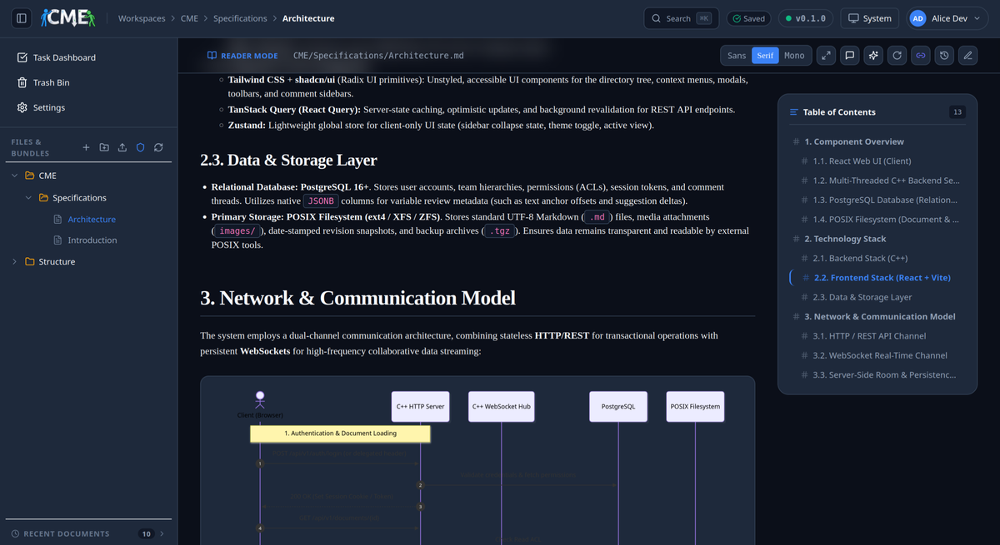

# Collaborative Markdown Editor (CME)

> **The modern collaborative knowledge platform that keeps your documentation in plain Markdown files on your own filesystem — with real-time editing, distraction-free reading, Google Docs-style reviews, inline suggestions, and an autonomous AI companion.**

[](docs/index.md)
[](docs/storage/layout.md)
[](docs/crdt/yrs_ffi.md)
[](docs/Architecture.md#35-autonomous-ai-agent-companion-dialog-sidecar)

---

> [!NOTE]
> For the comprehensive documentation, visual feature tour, architecture blueprints, guides, and API specifications, please see **[docs/index.md](docs/index.md)**.

---



---

## Why CME?

Engineering teams often find themselves trapped between two extremes:

* **Cloud Wiki Silos (Notion, Confluence, Google Docs):** Easy multi-user collaboration and commenting, but your knowledge is trapped in proprietary databases. You lose Git versioning, command-line tools, offline access, and complete ownership of your data.
* **Plain Git Repositories (GitHub, GitLab, Obsidian):** Complete data ownership and standard Markdown files, but reviewing documentation requires opening pull requests, and non-technical stakeholders struggle to read or contribute changes easily.

**CME delivers the best of both worlds:**

1. **Your Files, Your Storage:** Documents live as standard `.md` files and asset folders on your local or server filesystem. You can inspect them in terminal, commit them with Git, lint them with CI, and edit them in VS Code or Obsidian anytime.
2. **Real-Time Collaboration:** When colleagues open a document, changes sync live with sub-millisecond latency powered by `y-crdt` / `yrs`. You see each other's avatars, selections, and cursors moving in real time.
3. **Book-Quality Reader Experience:** Designed specifically for reading long-form technical documentation, architecture specs, and user guides with clean typography, responsive outlines, and interactive diagrams.
4. **Frictionless Review Workflows:** Leave anchored comments, reply in threads, and propose inline edits with visual red/green diffs that authors can accept with a single click.
5. **Autonomous AI Companion:** An integrated AI sidecar that understands your active document, answers questions, proposes modifications, and lets you jump directly to applied edits.
6. **Enterprise Security:** Multi-parent team permission hierarchies, directory inheritance, single sign-on (SSO), and granular access levels (`Read`, `Comment`, `Edit`, `Admin`).

---

## Quick Start (Run CME in 2 Minutes)

The easiest way to get started with CME is via Docker Compose:

```bash
# 1. Clone repository
git clone https://github.com/paulo-casanova/collaborative-markdown-editor.git cme
cd cme

# 2. Launch with Docker Compose
docker compose up -d
```

Open your browser at **`http://localhost:8080`** and start collaborating!

---

## Documentation Index

The complete documentation suite is located in the [`docs/`](docs/) directory. Start at **[docs/index.md](docs/index.md)** or jump directly to specific topics:

### Architecture & Engine Design
* **[Main Documentation & Feature Tour](docs/index.md)** — Detailed walk-through with screenshots covering reader mode, reviews, permissions, command palette, and settings.
* **[System Architecture](docs/Architecture.md)** — Complete technical blueprint covering the C++20 `uWebSockets` server daemon, thread pools, memory-mapped CRDT rooms, and storage boundaries.
* **[Native Yjs CRDT Collaboration Engine](docs/crdt/yrs_ffi.md)** — Integration of Rust's `y-crdt` / `yrs` via C-FFI, `CrdtDoc` RAII wrappers, and sub-millisecond in-memory synchronization.
* **[In-Memory Rooms & Persistence](docs/crdt/persistence.md)** — Debounced auto-save engine, crash-safe atomic POSIX file writes, and date-partitioned snapshots.
* **[Storage Layout & Document Bundles](docs/storage/layout.md)** — POSIX filesystem structure (`content/`, `.bundle/`, `trash/`, `snapshots/`) and companion asset pipelines.
* **[Atomic Storage Operations](docs/storage/atomic_writes.md)** — Zero-corruption guarantees using filesystem staging and POSIX atomic renames.

### Authoring & Syntax
* **[Markdown Syntax & Authoring Guide](docs/Markdown.md)** — Complete guide to CommonMark, GFM tables, Obsidian WikiLinks, callout alerts, status pills, KaTeX math formulas, and Mermaid diagrams.

### Access Control & Security
* **[Access Control (ACL) Model](docs/Access%20Controls.md)** — Mathematical DAG inheritance, recursive PostgreSQL CTE queries, and the 4-tier permission evaluation waterfall.
* **[Authentication & Identity Guide](docs/Authentication.md)** — Standalone challenge-response auth, reverse proxy SSO (`X-Remote-User`, `X-Remote-Email`), JIT user provisioning, and session token lifecycles.

### Deployment & Operations
* **[Building and Deploying CME](docs/Building%20and%20Deploying.md)** — Step-by-step compilation from source (GCC 13+, CMake, Ninja, Node.js), Systemd production service setup, Nginx and Caddy reverse proxy configurations, and backup runbooks.

### APIs & Protocols
* **[WebSocket Wire Protocol](docs/api/websocket_protocol.md)** — Binary framing specification, opcodes (`0x00`–`0x04`), state vector exchanges, and presence awareness.
* **[Document REST API](docs/api/documents.md)** — Workspaces, directory trees, document CRUD, raw markdown streaming, and bundle assets.
* **[Review Engine API](docs/api/review_engine.md)** — Endpoints and live events for threaded comments, inline suggestions, and tasks.
* **[Health & Observability API](docs/api/health.md)** — Health monitoring endpoints (`GET /api/v1/health`), operational metrics, and monitoring probes.
* **[Relational Database Schema](docs/database/schema.md)** — PostgreSQL tables, constraints, foreign keys, and indexes.
* **[Third-Party Dependencies & Licenses](docs/Dependencies.md)** — Comprehensive inventory of all backend and frontend libraries, versions, licenses, and usage purposes.
* **[Implementation Progress Log](docs/implementation_log.md)** — Historical implementation record, test verification, and development phases.

---

## License

This project is licensed under the MIT License.
