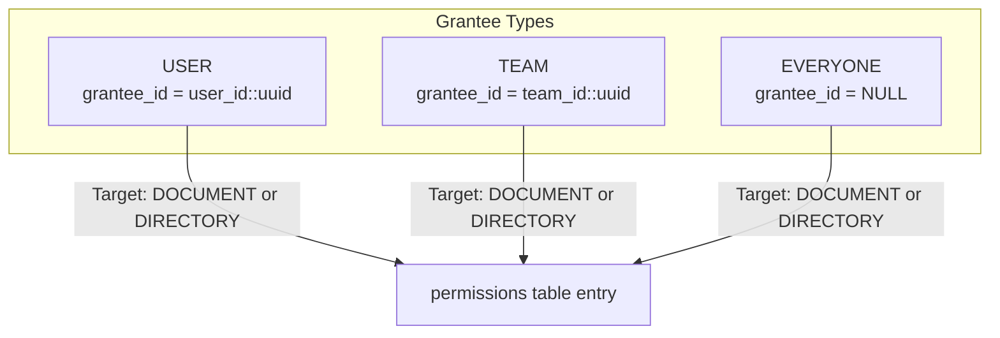
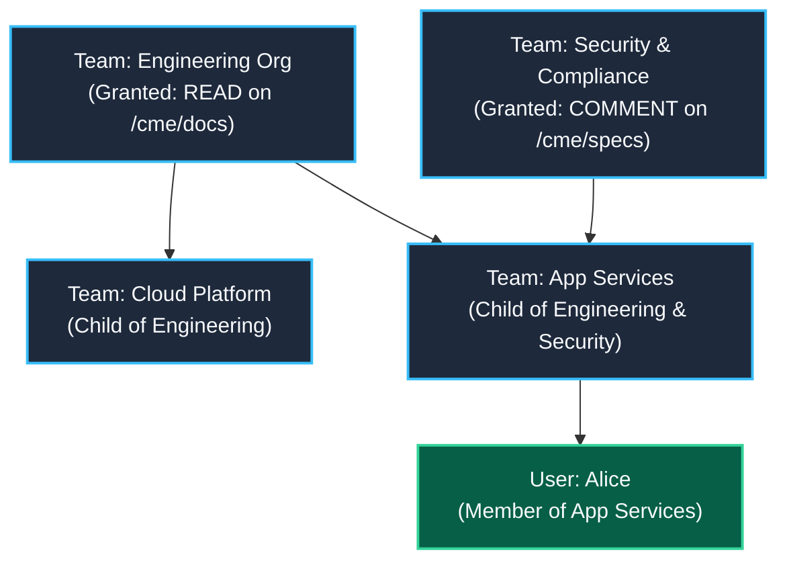
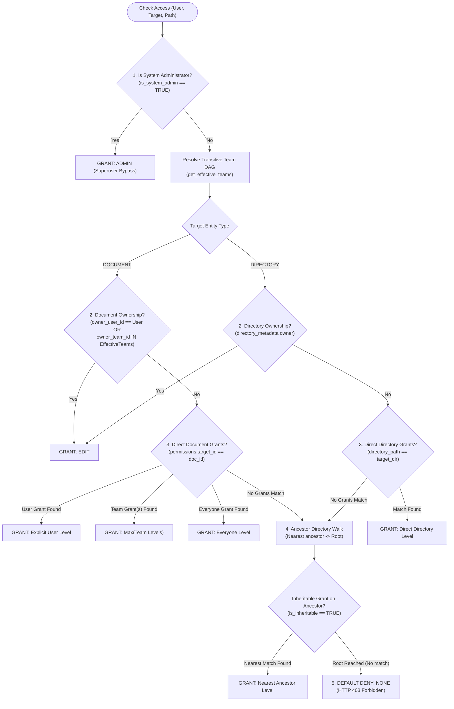
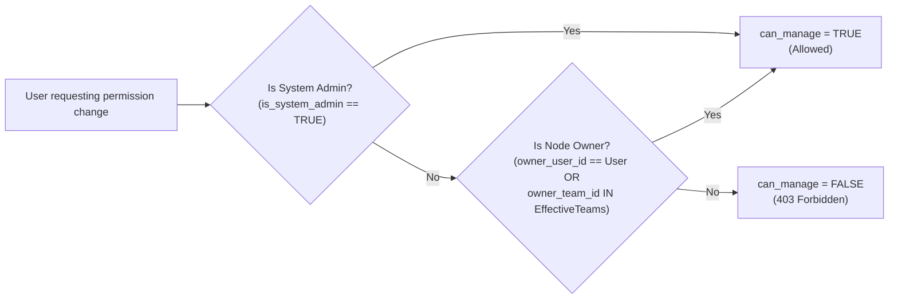

# Access Control (ACL) & Authorization Model

This document specifies the authorization architecture, Role-Based Access Control (RBAC) model, Directed Acyclic Graph (DAG) team inheritance, cumulative privilege scopes, and the permission evaluation waterfall in the **Collaborative Markdown Editor (CME)**.

> [!NOTE]
> This document focuses strictly on **Authorization (AuthZ)**: evaluating what authenticated principals are permitted to do on documents and directories. For authentication mechanisms (passwords, sessions, reverse-proxy headers, and agent PAT tokens), refer to [Authentication & Authorization API](api/auth.md).

---

## 1. Core Authorization Philosophy

CME enforces a granular, deterministic, and hierarchical access control model designed for modern, multi-team enterprise organizations:

* **Strict Default-Deny**: In the absence of an explicit grant, an inherited ancestor grant, or node ownership, access is refused (`NONE`, HTTP 403 Forbidden).
* **Multi-Parent Team DAG**: Teams are not confined to a rigid single-parent hierarchy. Teams form a Directed Acyclic Graph (DAG), modeling cross-functional organizations where a team can inherit privileges from multiple parent teams simultaneously.
* **Document & Directory Scopes**: Access can be granted directly on individual documents or on virtual directory paths (`directory_path`).
* **Inheritable vs. Non-Inheriting Grants**: Directory ACL entries can be flagged as `is_inheritable = TRUE` (cascading downward to all subdirectories and files) or `is_inheritable = FALSE` (applying strictly to the directory itself).
* **Deterministic Waterfall Resolution**: Access level evaluation follows a deterministic priority order: System Admin $\rightarrow$ Node Ownership $\rightarrow$ Explicit Node ACL $\rightarrow$ Nearest Ancestor Directory Inheritance $\rightarrow$ Default Deny.

---

## 2. Cumulative Access Levels

CME defines five cumulative privilege tiers:


Each level subsumes all rights granted by lower tiers:

| Access Level | Numeric | Permitted Operations | Restricted Operations |
| :--- | :---: | :--- | :--- |
| **`NONE`** | `0` | None. Node is excluded from workspace file tree listings. | All read and write operations rejected with HTTP 403 Forbidden. |
| **`READ`** | `1` | View document markdown; render HTML; fetch companion bundle assets (`.bundle/`). | Cannot type in editor; cannot leave comments or submit suggestions. |
| **`COMMENT`** | `2` | All `READ` rights; add threaded inline comments; submit text replacement suggestions; check/uncheck tasks assigned to self. | Direct text typing in CodeMirror disabled; cannot merge suggestions or delete document. |
| **`EDIT`** | `3` | All `COMMENT` rights; live real-time collaborative editing (Yjs CRDT keystrokes); merge/reject suggestions; upload bundle assets; create and assign tasks. | Cannot alter document ACLs; cannot transfer ownership; cannot permanently delete document. |
| **`ADMIN`** | `4` | All `EDIT` rights; modify node permissions (`POST /api/v1/workspaces/permissions`); delete ACL grants; transfer node ownership; soft-delete or restore documents. | System-wide administrative controls (reserved for system admins). |

---

## 3. Principals & Grantee Types

Permissions can be granted to three classes of principals in the `permissions` table:



1. **`USER`**: Explicitly targets a single user account via `grantee_id` (UUID). User-specific grants take precedence over team and everyone grants.
2. **`TEAM`**: Targets a team entity via `grantee_id` (UUID). Access applies to all direct members of the team and all transitive descendant teams in the DAG.
3. **`EVERYONE`**: Broad grant targeting all authenticated users in the workspace without requiring a specific `grantee_id`. Used for public reading or org-wide commenting.

---

## 4. Multi-Parent Team DAG (Directed Acyclic Graph)

### The Team Graph Model
In enterprise environments, organizations are organized functionally and cross-functionally. CME represents teams as a **Directed Acyclic Graph (DAG)** via two relational tables:
* `team_members (team_id, user_id, role)`: Direct user memberships.
* `team_parents (parent_team_id, child_team_id)`: Hierarchical inheritance relationships where child teams inherit permissions granted to parent teams.



In the diagram above, user `Alice` belongs directly to `App Services`. Through transitive DAG resolution, Alice automatically inherits:
* All grants assigned to `App Services` (direct membership).
* All grants assigned to `Engineering Org` (via `App Services` $\rightarrow$ `Engineering Org`).
* All grants assigned to `Security & Compliance` (via `App Services` $\rightarrow$ `Security & Compliance`).

### Transitive DAG Resolution (Recursive CTE)
When evaluating permissions, [`PermissionEngine::get_effective_teams`](file:///home/pasc/cme/backend/src/db/permission_engine.cpp#L13-L50) executes a recursive Common Table Expression (CTE) in PostgreSQL:

```sql
WITH RECURSIVE effective_teams AS (
    -- 1. Base case: Teams the user directly belongs to
    SELECT team_id
    FROM team_members
    WHERE user_id = $1::uuid

    UNION

    -- 2. Recursive step: Ascend through all ancestor teams
    SELECT tp.parent_team_id
    FROM team_parents tp
    JOIN effective_teams et ON tp.child_team_id = et.team_id
)
SELECT team_id::text FROM effective_teams;
```

#### Graph Invariants:
1. **Cycle Prevention**: The database layer uses `UNION` (which deduplicates visited team IDs) and a constraint `CHECK (parent_team_id <> child_team_id)`. Administrative APIs reject cycle introductions.
2. **Multi-Team Privilege Aggregation**: If a user inherits permissions from multiple teams on the same target, the engine resolves to `MAX(team_access_levels)`. For example, if Team A grants `READ` (1) and Team B grants `EDIT` (3), the user receives `EDIT` (3).

---

## 5. Permission Evaluation Waterfall

When an authenticated user requests access to a target node (a document with `document_id` or a directory path `fs_path`), [`PermissionEngine::check_permission`](file:///home/pasc/cme/backend/src/db/permission_engine.cpp#L83-L285) evaluates the access request through a deterministic 5-stage waterfall:



---

### Step-by-Step Waterfall Rules

#### Step 1: System Administrator Bypass
* If `users.is_system_admin` is `TRUE`, the user is granted `ADMIN` access immediately.
* System administrators bypass all document and directory ACLs, can view all documents, and can manage all permissions.

#### Step 2: Direct Node Ownership
* **Documents**: Checked in table `documents (owner_user_id, owner_team_id)`.
  * If `owner_user_id == user.id`, owner receives `EDIT`.
  * If `owner_team_id` is contained in the user's transitive effective teams, member receives `EDIT`.
* **Directories**: Checked in table `directory_metadata (directory_path, owner_user_id, owner_team_id)`.
  * If matching ownership exists, user receives `EDIT`.
* *(Note: Ownership establishes a baseline of `EDIT`. If an explicit ACL grant awards `ADMIN`, the higher level takes precedence).*

#### Step 3: Direct Explicit ACL Grants
If the node is not owned by the user, the engine queries the `permissions` table for entries targeting the node directly:
* **Documents**: `target_type = 'DOCUMENT' AND target_id = $doc_id`
* **Directories**: `target_type = 'DIRECTORY' AND directory_path = $clean_dir`

Within direct grants, matching rules follow strict precedence:
1. **Direct `USER` match**: If an explicit grant matches `user_id`, that level is selected.
2. **Direct `TEAM` match**: If one or more explicit grants match any of the user's effective teams, `MAX(team_levels)` is selected.
3. **Direct `EVERYONE` match**: If an `EVERYONE` grant exists, that level is selected.

> [!IMPORTANT]
> **Explicit Document Grants Override Directory Inheritance**: If an explicit grant or direct ownership exists on a document, evaluation terminates at Step 3. Directory inheritance is only consulted if no direct document grant matches.

#### Step 4: Nearest Ancestor Directory Inheritance Walk
If no direct grant exists on the document (or sub-directory), the engine walks upward through the directory path hierarchy from the immediate parent directory to the root directory `""`:

$$\text{Path: } \texttt{/cme/docs/specs/v2} \longrightarrow \texttt{cme/docs/specs} \longrightarrow \texttt{cme/docs} \longrightarrow \texttt{cme} \longrightarrow \texttt{"" (Root)}$$

At each directory level:
1. Check directory ownership in `directory_metadata`.
2. Query `permissions` table for entries where `target_type = 'DIRECTORY' AND directory_path = current_dir`.
3. **Inheritability Filter**: For ancestor directories, only grants with **`is_inheritable = TRUE`** are considered. Grants marked `is_inheritable = FALSE` are ignored during ancestor walks.
4. If an ancestor matches (`USER` > `TEAM` > `EVERYONE`):
   * **Nearest Ancestor Wins**: The walk halts immediately upon finding the first matching ancestor directory. An explicit grant at `cme/docs` overrides grants defined higher up at `cme` or root `""`.

#### Step 5: Default Deny
If the root directory `""` is evaluated and no ownership or inheritable grant matches the user, access evaluates to **`NONE`** (HTTP 403 Forbidden).

---

## 6. Directory Inheritance & Additive Permissions

### Inheritable vs. Non-Inheriting Grants
When granting permissions on a directory, administrators configure the `is_inheritable` flag:

```mermaid
flowchart TD
    Dir["Directory: /engineering<br/>ACL: is_inheritable = TRUE (EDIT)"]
    SubDir["Sub-directory: /engineering/backend"]
    Doc["Document: /engineering/backend/arch.md"]

    Dir -.->|"Cascades Downward"| SubDir
    SubDir -.->|"Cascades Downward"| Doc

    Dir2["Directory: /finance<br/>ACL: is_inheritable = FALSE (READ)"]
    Doc2["Document: /finance/payroll.md"]

    Dir2 -.x|"Does NOT Cascade"| Doc2
```

1. **`is_inheritable = TRUE` (Default)**:
   * The grant applies to the directory and automatically cascades downward to all child subdirectories, nested folders, and documents.
   * Displayed in the UI under **Inherited Permissions** with a badge indicating the source directory (`from: /engineering`).
2. **`is_inheritable = FALSE` (Non-inheriting)**:
   * The grant applies *only* to the directory itself (e.g., allowing a user to list directory contents or view directory metadata in `DirectoryView`), but does *not* grant access to any child documents inside that directory.

### Non-Destructive Nature of Inherited ACLs
In CME, permissions cascade downward additively:
* An inherited permission from a parent directory cannot be deleted or revoked at the child node level.
* In the UI, inherited grants do not render delete buttons and include a notice: *“Permissions in CME are additive: inheritable grants at parent directories propagate downward to children and cannot be revoked locally.”*
* To change an inherited grant, an administrator must either:
  1. Modify or revoke the grant at the parent directory where it was created, OR
  2. Place an explicit direct grant on the child document or subdirectory, which takes precedence over inherited grants.

---

## 7. Permission Management & Delegation (`can_manage`)

The permission engine enforces distinct rules governing who is authorized to inspect, grant, revoke, or transfer permissions on a node (`can_manage`):



### Delegation Rules:
1. **System Administrators**: Always have `can_manage = TRUE` on all documents and directories.
2. **Node Owners**: A document owner or directory owner (user or member of the owning team) has `can_manage = TRUE`.
3. **Regular Users**: Users with `EDIT` or `READ` access **cannot** modify ACLs or transfer ownership. Only administrators or owners may manage permissions.

### Administrative API Endpoints:
* `GET /api/v1/workspaces/permissions`: Retrieves explicit grants, inherited grants, effective permissions, and owner provenance.
* `POST /api/v1/workspaces/permissions`: Adds or updates an explicit grant on a document or directory.
* `DELETE /api/v1/workspaces/permissions/:id`: Revokes an explicit grant by ID.
* `POST /api/v1/workspaces/permissions/owner`: Transfers ownership of a document or directory to a designated user or team.
* `POST /api/v1/workspaces/permissions/test`: Test permissions simulator: evaluates how CME's waterfall rules resolve for any user or team without altering database state.

---

## 8. Concrete Evaluation Scenarios

### Scenario A: Diamond DAG Team Inheritance

```text
Teams:
  - Engineering (ID: t_eng)
  - Web Platform (ID: t_web)
  - Frontend Devs (ID: t_front) -> Child of Engineering AND Web Platform

User:
  - Charlie (ID: u_charlie) -> Member of Frontend Devs

Grants on document 'design_system.md':
  - Team Engineering: READ (1)
  - Team Web Platform: EDIT (3)
```

* **Resolution**:
  1. Charlie belongs to `Frontend Devs`.
  2. Recursive CTE resolves effective teams: `{t_front, t_eng, t_web}`.
  3. No explicit user grant for Charlie.
  4. Team grants match `t_eng` (`READ`) and `t_web` (`EDIT`).
  5. The engine computes $\max(\text{READ}, \text{EDIT}) = \text{EDIT}$.
  6. **Effective Access**: `EDIT` (3). Charlie can edit the document collaboratively.

---

### Scenario B: Directory Inheritance with Document Override

```text
Directory Hierarchy:
  - /projects/secret/
    - ACL: Team Engineering -> EDIT (is_inheritable = TRUE)

Document:
  - /projects/secret/confidential.md
    - ACL: Team Engineering -> COMMENT
```

* **Resolution**:
  1. User Bob is in `Engineering`.
  2. The document `confidential.md` has an explicit grant for `Engineering` (`COMMENT`).
  3. Because direct document grants take precedence (Step 3 of the waterfall), evaluation terminates immediately.
  4. The directory's `EDIT` grant is **not** inherited.
  5. **Effective Access**: `COMMENT` (2). Bob can leave comments and review suggestions, but cannot edit the text directly.

---

### Scenario C: Nearest Ancestor Wins

```text
Directory Hierarchy:
  - / (Root)
    - ACL: EVERYONE -> READ (is_inheritable = TRUE)
  - /restricted/
    - ACL: EVERYONE -> NONE / No grant (is_inheritable = TRUE)
    - ACL: Team Security -> EDIT (is_inheritable = TRUE)
  - /restricted/reports/
    - (No explicit ACLs)
  - /restricted/reports/audit.md
    - (No explicit ACLs)
```

* **Resolution for User Dave (Not in Team Security)**:
  1. No explicit ACL on `audit.md`.
  2. Upward directory walk:
     * Check `/restricted/reports`: No ACLs.
     * Check `/restricted`: Explicit ACL for `Team Security` (`EDIT`). Dave is not a member. No other inheritable grants match Dave.
     * **Nearest Ancestor Halts**: Because `/restricted` has defined ACL rules, the engine stops evaluating and does **not** fall back to Root `/`.
  3. **Effective Access**: `NONE` (0). Dave is blocked from accessing the audit report.

---

## 9. Database Schema Reference

The authorization subsystem is governed by four core PostgreSQL tables:

```sql
-- 1. Explicit Document & Directory Permissions
CREATE TABLE permissions (
    id BIGSERIAL PRIMARY KEY,
    target_type VARCHAR(16) NOT NULL CHECK (target_type IN ('DOCUMENT', 'DIRECTORY')),
    target_id UUID REFERENCES documents(id) ON DELETE CASCADE,
    directory_path VARCHAR(1024),
    grantee_type VARCHAR(16) NOT NULL CHECK (grantee_type IN ('USER', 'TEAM', 'EVERYONE')),
    grantee_id UUID,
    access_level VARCHAR(16) NOT NULL CHECK (access_level IN ('READ', 'COMMENT', 'EDIT', 'ADMIN')),
    is_inheritable BOOLEAN NOT NULL DEFAULT TRUE,
    created_at TIMESTAMPTZ NOT NULL DEFAULT NOW(),
    updated_at TIMESTAMPTZ NOT NULL DEFAULT NOW(),
    CONSTRAINT chk_target_spec CHECK (
        (target_type = 'DOCUMENT' AND target_id IS NOT NULL AND directory_path IS NULL) OR
        (target_type = 'DIRECTORY' AND target_id IS NULL AND directory_path IS NOT NULL)
    ),
    CONSTRAINT chk_grantee_spec CHECK (
        (grantee_type IN ('USER', 'TEAM') AND grantee_id IS NOT NULL) OR
        (grantee_type = 'EVERYONE')
    )
);

-- 2. Multi-Parent Team Hierarchies (DAG)
CREATE TABLE team_parents (
    parent_team_id UUID NOT NULL REFERENCES teams(id) ON DELETE CASCADE,
    child_team_id UUID NOT NULL REFERENCES teams(id) ON DELETE CASCADE,
    created_at TIMESTAMPTZ NOT NULL DEFAULT NOW(),
    PRIMARY KEY (parent_team_id, child_team_id),
    CHECK (parent_team_id <> child_team_id)
);

-- 3. Team Memberships
CREATE TABLE team_members (
    team_id UUID NOT NULL REFERENCES teams(id) ON DELETE CASCADE,
    user_id UUID NOT NULL REFERENCES users(id) ON DELETE CASCADE,
    role VARCHAR(32) NOT NULL DEFAULT 'member',
    created_at TIMESTAMPTZ NOT NULL DEFAULT NOW(),
    PRIMARY KEY (team_id, user_id)
);

-- 4. Directory Ownership & Metadata
CREATE TABLE directory_metadata (
    directory_path VARCHAR(1024) PRIMARY KEY,
    owner_user_id UUID REFERENCES users(id) ON DELETE SET NULL,
    owner_team_id UUID REFERENCES teams(id) ON DELETE SET NULL,
    created_at TIMESTAMPTZ NOT NULL DEFAULT NOW(),
    updated_at TIMESTAMPTZ NOT NULL DEFAULT NOW()
);
```

---

## 10. Audit & Compliance

All authorization mutations generate structured audit logs stored in the `audit_logs` table:

* **Logged Operations**: `SET_PERMISSION`, `DELETE_PERMISSION`, `TRANSFER_OWNERSHIP`, `DELETE_DOCUMENT`.
* **Metadata Captured**: Timestamp (`created_at`), Acting User ID (`user_id`), IP address, User-Agent, Target Type & Path (`target_path`), Result Status (`SUCCESS`, `DENIED`, `ERROR`), and structured JSON diff payload (`parameters`).
* **Tamper-Evidence**: Audit records are insert-only; no API endpoints permit updating or deleting rows from `audit_logs`.
