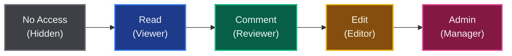
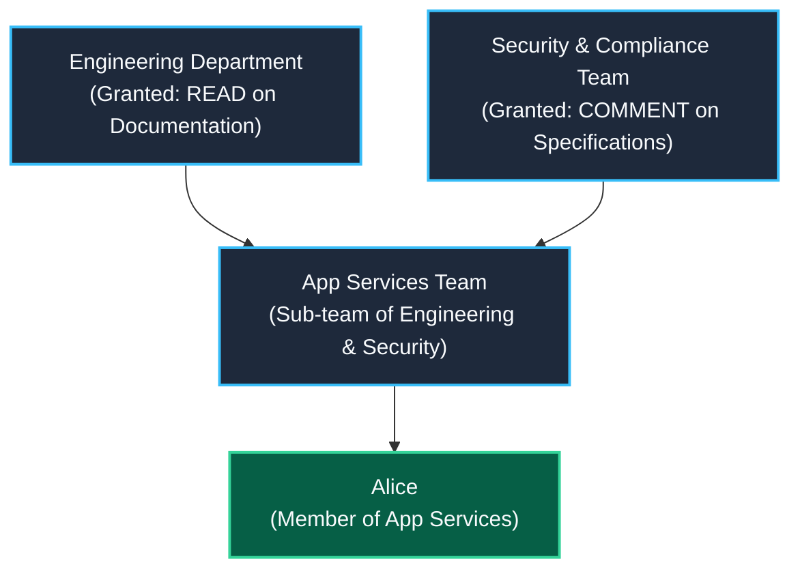
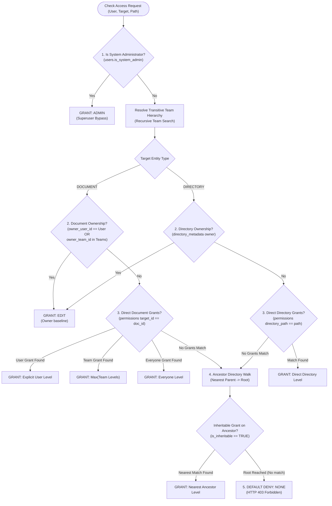
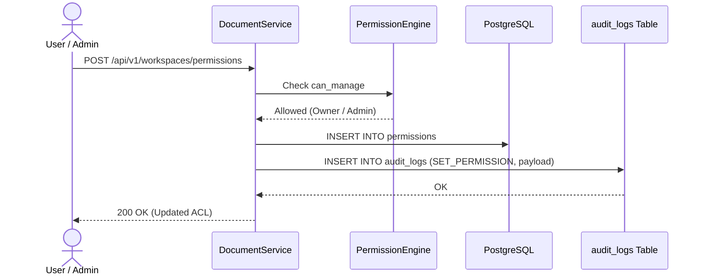

# Access Control & Permissions Guide

This document describes the access control and authorization system of the **Collaborative Markdown Editor (CME)**. 

The guide is divided into two parts:
* **Part I: Conceptual & User Guide** — Written for general users, document authors, project managers, and team leads who need to share, organize, and manage permissions on documents and folders.
* **Part II: Technical Architecture & System Reference** — Written for developers, systems architects, and database administrators who need deep insight into the evaluation algorithms, C++ backend engine, REST API contracts, and database schema.

---

# Part I: Conceptual & User Guide

## 1. Introduction & Security Philosophy

CME is designed for collaborative environments where information must be shared seamlessly across teams while remaining strictly protected where necessary. 

The access control model is built on four core principles:

1. **Secure by Default (Default-Deny)**: If you haven't been given access to a document or folder (either directly, through your team, or through an open folder), you cannot see or open it. Documents you cannot read will not even show up in your file browser.
2. **Cumulative Access Levels**: Permissions follow a ladder of privileges. Having a higher level automatically gives you all the rights of the lower levels.
3. **Additive Permissions (No Accidental Lockouts)**: Permissions cascade downward from parent folders to child folders and documents. If your department folder gives you Read access, a subfolder cannot accidentally revoke your Read access unless a specific folder rule takes precedence.
4. **Flexible Team Organization**: Teams can belong to other teams. If you join the *Mobile Development* team, and that team is part of the broader *Engineering* organization, you automatically receive access to all Engineering resources without anyone having to configure your account manually.

> [!NOTE]
> This document explains **Authorization** (what you are allowed to view, edit, or manage). It assumes you have already logged in through your organization's authentication system (passwords, single sign-on, or access tokens).

---

## 2. Permission Levels Explained

CME provides five simple access levels:



Each level builds upon the previous one:

| Access Level | Role Name | What You Can Do | What You Cannot Do |
| :--- | :--- | :--- | :--- |
| **`NONE`** | **No Access** | Nothing. The document or folder is completely invisible in your file tree. | Cannot view, read, search, or edit. |
| **`READ`** | **Viewer** | Read the document, view rendered diagrams and math formulas, download attached images and files in the document's bundle. | Cannot type in the editor, leave comments, or check tasks. |
| **`COMMENT`** | **Reviewer** | Everything a Viewer can do, plus: highlight text to leave threaded comments, suggest text replacements, and complete action items assigned to you. | Cannot type directly in the live document, merge suggestions, or delete the document. |
| **`EDIT`** | **Editor** | Everything a Reviewer can do, plus: write and edit text live with colleagues in real time, accept or reject review suggestions, upload new files/images, and create new tasks. | Cannot change permissions, transfer document ownership, or permanently delete the document. |
| **`ADMIN`** | **Manager** | Everything an Editor can do, plus: share the document, grant or revoke permissions for other users and teams, transfer ownership, and delete or restore files. | Cannot alter global system settings (reserved for System Administrators). |

---

## 3. Who Can Have Access? (Users, Teams, and Everyone)

When you share a document or folder, you can grant access to three categories of recipients:

1. **Individual Users**: You can give access directly to a specific person (e.g., granting Alice *Edit* access). Direct user permissions are the most specific.
2. **Teams**: You can give access to an entire team (e.g., granting *Product Managers* *Comment* access). Every member of that team immediately gains that access.
3. **Everyone (Organization-Wide)**: You can grant access to all logged-in members of the workspace. This is ideal for company handbooks, public specifications, or shared templates.

### Smart Team Hierarchies
Teams in CME are organized naturally. A specialized team can be a sub-team of one or more larger departments:



In this example:
* Alice belongs to the **App Services** team.
* Because **App Services** is part of **Engineering**, Alice automatically inherits *Read* access to Engineering Documentation.
* Because **App Services** is also part of **Security & Compliance**, Alice also gets *Comment* access to Specifications.
* Alice gets the combined highest permissions across all teams she belongs to.

---

## 4. How Folders and Documents Inherit Access

### 1. Folders Pass Access Down to Their Contents
When you grant access to a folder, everything inside that folder—subfolders, child folders, and individual markdown files—automatically inherits that access.

> [!TIP]
> **Best Practice**: Whenever possible, manage permissions at the folder level rather than on individual files. For example, give your team *Edit* access to `/projects/my-project`, and every new document created in that folder will automatically be editable by your teammates.

### 2. Cascading vs. Folder-Only Sharing
When sharing a folder, you have an option:
* **Apply to all contents inside (Default)**: Everyone granted access can see and access every document and subfolder inside.
* **Just this folder (Folder-only)**: Users can see the folder in their sidebar and browse its directory listing, but they cannot open the documents inside unless granted access specifically.

### 3. Document Overrides
You can always grant special permissions on an individual document inside a folder.
* **Giving someone extra access**: A folder might be *Read-only* for the general public, but you can give a specific author *Edit* access to one document inside it.
* **Restricting access**: If a document has an explicit permission set directly on it, that document's specific rule takes priority over whatever the folder granted.

### 4. Non-Destructive Inheritance
In CME, permissions granted at a parent folder are **additive**:
* You cannot accidentally "break" or delete a parent folder's permission rule from inside a sub-document's sharing settings.
* In the sharing dialog, permissions coming from parent folders are clearly labeled with a badge (e.g., `Inherited from: /projects`).
* If you need to revoke an inherited permission, you simply adjust the rule on the parent folder where it was originally created.

---

## 5. Everyday Collaboration Scenarios

### Scenario 1: Company Handbook (Public Read, Team Edit)
* **Folder**: `/handbook`
* **Rule 1**: *Everyone* is granted **`READ`**.
* **Rule 2**: *HR Team* is granted **`EDIT`**.
* **Result**: Every employee can browse and read the handbook, but only members of the HR team can modify its contents.

### Scenario 2: Contractor Reviewing a Single Document
* **Folder**: `/engineering/backend` (shared with the Engineering team as **`EDIT`**).
* **Document**: `/engineering/backend/api-audit.md`.
* **Action**: You add an explicit rule on `api-audit.md` granting external contractor *Carol* **`COMMENT`** access.
* **Result**: Carol can open `api-audit.md` and leave review comments, but she cannot see any other files in the `/engineering/backend` folder.

### Scenario 3: Confidential Executive Notes in a Department Folder
* **Folder**: `/finance` (accessible to the Finance team as **`EDIT`**).
* **Subfolder**: `/finance/executive-compensation`.
* **Action**: An explicit rule is added on `/finance/executive-compensation` giving access only to the *Executive Board*.
* **Result**: Regular finance team members cannot see or enter the `executive-compensation` folder, even though they have access to the rest of `/finance`.

---

# Part II: Technical Architecture & System Reference

## 6. The Permission Evaluation Waterfall

When an authenticated principal requests access to a target document or directory, CME resolves effective permissions via a deterministic 5-stage waterfall algorithm:



### Detailed Evaluation Steps:

#### Step 1: System Administrator Bypass
* If `users.is_system_admin` is `TRUE`, the user immediately receives `ADMIN` (4).
* System administrators bypass all document and directory ACLs, can view all workspaces, and can manage all permissions.

#### Step 2: Direct Node Ownership
* **Documents**: Checked in table `documents (owner_user_id, owner_team_id)`.
  * If `owner_user_id == user.id`, owner receives `EDIT` (3).
  * If `owner_team_id` matches any of the user's effective teams, member receives `EDIT` (3).
* **Directories**: Checked in table `directory_metadata (directory_path, owner_user_id, owner_team_id)`.
  * If matching user or team ownership exists, the caller receives `EDIT` (3).
* *(Note: Ownership establishes a baseline of `EDIT`. If an explicit ACL entry awards `ADMIN`, the higher level takes precedence).*

#### Step 3: Direct Explicit ACL Grants
If the node is not owned by the caller, CME queries the `permissions` table for entries targeting the node directly:
* **Documents**: `target_type = 'DOCUMENT' AND target_id = $doc_id`
* **Directories**: `target_type = 'DIRECTORY' AND directory_path = $clean_dir`

Within direct grants, matching rules follow strict precedence:
1. **Explicit `USER` match**: If an entry exists for the user's UUID, that level is returned immediately.
2. **Explicit `TEAM` match**: If entries exist matching any of the user's effective teams, `MAX(team_levels)` is returned.
3. **Explicit `EVERYONE` match**: If an `EVERYONE` entry exists, that level is returned.

> [!IMPORTANT]
> **Explicit Grants Terminate Evaluation**: If a document has an explicit ACL entry (or direct ownership), evaluation stops at Step 3. Directory inheritance is only consulted if no direct grants match the caller.

#### Step 4: Nearest Ancestor Directory Walk
If no direct grant matches, CME walks upward through the directory path segments from the immediate parent folder to the root directory `""`:

$$\text{Path: } \texttt{/cme/docs/specs/v2} \longrightarrow \texttt{cme/docs/specs} \longrightarrow \texttt{cme/docs} \longrightarrow \texttt{cme} \longrightarrow \texttt{"" (Root)}$$

At each directory level:
1. Check directory ownership in `directory_metadata`.
2. Query `permissions` for entries where `target_type = 'DIRECTORY' AND directory_path = current_segment`.
3. Filter by **`is_inheritable = TRUE`**. Any entry with `is_inheritable = FALSE` is ignored during ancestor walks.
4. If an ancestor matches (`USER` > `TEAM` > `EVERYONE`):
   * **Nearest Ancestor Wins**: The walk halts immediately upon finding the first matching ancestor directory. Grants defined higher up at parent folders are not consulted.

#### Step 5: Default Deny
If the root directory `""` is reached without finding any matching grant or ownership, the engine returns **`NONE`** (0), resulting in an HTTP 403 Forbidden response.

---

## 7. Multi-Parent Team Graph & DAG Resolution

### Relational Representation
Teams form a Directed Acyclic Graph (DAG) rather than a simple tree. This is represented by two relational tables:
* `team_members (team_id, user_id, role)`: Direct user memberships.
* `team_parents (parent_team_id, child_team_id)`: Multi-parent edges where child teams inherit rights from parent teams.

### Recursive CTE Resolution
When resolving the effective team set for a user, the backend executes a recursive Common Table Expression (CTE):

```sql
WITH RECURSIVE effective_teams AS (
    -- 1. Base case: Teams the user directly belongs to
    SELECT team_id
    FROM team_members
    WHERE user_id = $1::uuid

    UNION

    -- 2. Recursive step: Ascend through all parent and ancestor teams
    SELECT tp.parent_team_id
    FROM team_parents tp
    JOIN effective_teams et ON tp.child_team_id = et.team_id
)
SELECT team_id::text FROM effective_teams;
```

### Graph Invariants:
1. **Cycle Prevention**: The database layer uses `UNION` (which deduplicates visited team IDs) and a constraint `CHECK (parent_team_id <> child_team_id)`. Administrative APIs reject cycle introductions.
2. **Multi-Team Privilege Aggregation**: When a user belongs to multiple teams that have different access levels on the same target, CME computes `MAX(levels)`. For example, `READ` (1) and `EDIT` (3) resolves to `EDIT` (3).

---

## 8. Backend Architecture & C++ Implementation

### Core Classes & Responsibilities

#### 1. `cme::db::PermissionEngine`
Located in [`backend/src/db/permission_engine.cpp`](file:///home/pasc/cme/backend/src/db/permission_engine.cpp), this is the low-level engine executing database queries:
* **`get_effective_teams(tx, user_id)`**: Executes the recursive CTE to resolve all ancestor teams for a given user.
* **`check_permission(tx, user_id, target_type, target_id, path)`**: Executes the 5-stage evaluation waterfall and returns the cumulative `AccessLevel` enum (`NONE`, `READ`, `COMMENT`, `EDIT`, `ADMIN`).
* **`get_permission_details(tx, user_id, target_type, target_id, path)`**: Returns a comprehensive diagnostic bundle including:
  * `effective_level`: The resolved access level.
  * `can_manage`: Boolean indicating whether the caller may edit ACLs.
  * `explicit_grants`: Vector of grants assigned directly to this node.
  * `inherited_grants`: Vector of grants inherited from ancestor folders, including source directory paths.
  * `owner_user_id` / `owner_team_id`: Provenance information.
* **`delete_node_permission(tx, permission_id, requesting_user_id)`**: Validates caller authority (`can_manage`) and safely deletes an explicit permission entry.
* **`transfer_node_ownership(tx, target_type, target_id, path, new_owner_user_id, new_owner_team_id, requesting_user_id)`**: Safely transfers ownership to a new user or team.

#### 2. `cme::service::DocumentService`
Located in [`backend/src/service/document_service.cpp`](file:///home/pasc/cme/backend/src/service/document_service.cpp), coordinates business logic and access control enforcement:
* Wraps all read, write, update, and delete actions with `check_permission`.
* Enforces `can_manage` delegation: only node owners and system administrators may alter permissions or transfer ownership.
* Emits structured audit log events into PostgreSQL upon authorization mutations.

---

## 9. REST API Reference

The authorization subsystem provides five dedicated REST endpoints under `/api/v1/workspaces/permissions`:

### 1. Get Node Permissions
```http
GET /api/v1/workspaces/permissions?target_type={DOCUMENT|DIRECTORY}&target_id={UUID}&directory_path={PATH}
```
* **Authorization**: Caller must have at least `READ` access to the node.
* **Response**: Returns `explicit_grants`, `inherited_grants`, `effective_level`, and `can_manage`.

### 2. Add or Update Permission Grant
```http
POST /api/v1/workspaces/permissions
Content-Type: application/json

{
  "target_type": "DOCUMENT",
  "target_id": "9b1deb4d-3b7d-4bad-9bdd-2b0d7b3dcb6d",
  "grantee_type": "TEAM",
  "grantee_id": "e4b2d5a1-7c3e-4b89-a5c2-3f8d9b1c2e4f",
  "access_level": "EDIT",
  "is_inheritable": true
}
```
* **Authorization**: Caller must have `can_manage = TRUE` (Node Owner or System Administrator).

### 3. Revoke Permission Grant
```http
DELETE /api/v1/workspaces/permissions/:permission_id
```
* **Authorization**: Caller must have `can_manage = TRUE`.
* **Restriction**: Only explicit grants can be deleted. Attempting to delete an inherited permission returns HTTP 400.

### 4. Transfer Ownership
```http
POST /api/v1/workspaces/permissions/owner
Content-Type: application/json

{
  "target_type": "DIRECTORY",
  "directory_path": "engineering/specs",
  "new_owner_user_id": "a1b2c3d4-e5f6-7a8b-9c0d-1e2f3a4b5c6d",
  "new_owner_team_id": null
}
```
* **Authorization**: Caller must be the current Node Owner or a System Administrator.

### 5. Simulate Permissions (Test Engine)
```http
POST /api/v1/workspaces/permissions/test
Content-Type: application/json

{
  "user_id": "a1b2c3d4-e5f6-7a8b-9c0d-1e2f3a4b5c6d",
  "target_type": "DOCUMENT",
  "target_id": "9b1deb4d-3b7d-4bad-9bdd-2b0d7b3dcb6d"
}
```
* **Description**: Diagnostic simulator. Runs the evaluation waterfall for any specified user or team without altering any database records.

---

## 10. Database Schema Reference

The authorization model is implemented across four primary PostgreSQL tables:

```sql
-- 1. Explicit Document & Directory Permissions
CREATE TABLE permissions (
    id BIGSERIAL PRIMARY KEY,
    target_type VARCHAR(16) NOT NULL CHECK (target_type IN ('DOCUMENT', 'DIRECTORY')),
    target_id UUID REFERENCES documents(id) ON DELETE CASCADE,
    directory_path VARCHAR(1024),
    grantee_type VARCHAR(16) NOT NULL CHECK (grantee_type IN ('USER', 'TEAM', 'EVERYONE')),
    grantee_id UUID,
    access_level VARCHAR(16) NOT NULL CHECK (access_level IN ('READ', 'COMMENT', 'EDIT', 'ADMIN')),
    is_inheritable BOOLEAN NOT NULL DEFAULT TRUE,
    created_at TIMESTAMPTZ NOT NULL DEFAULT NOW(),
    updated_at TIMESTAMPTZ NOT NULL DEFAULT NOW(),
    CONSTRAINT chk_target_spec CHECK (
        (target_type = 'DOCUMENT' AND target_id IS NOT NULL AND directory_path IS NULL) OR
        (target_type = 'DIRECTORY' AND target_id IS NULL AND directory_path IS NOT NULL)
    ),
    CONSTRAINT chk_grantee_spec CHECK (
        (grantee_type IN ('USER', 'TEAM') AND grantee_id IS NOT NULL) OR
        (grantee_type = 'EVERYONE')
    )
);

CREATE INDEX idx_permissions_document ON permissions(target_id) WHERE target_type = 'DOCUMENT';
CREATE INDEX idx_permissions_directory ON permissions(directory_path) WHERE target_type = 'DIRECTORY';
CREATE INDEX idx_permissions_grantee ON permissions(grantee_type, grantee_id);

-- 2. Multi-Parent Team Hierarchy (DAG)
CREATE TABLE team_parents (
    parent_team_id UUID NOT NULL REFERENCES teams(id) ON DELETE CASCADE,
    child_team_id UUID NOT NULL REFERENCES teams(id) ON DELETE CASCADE,
    created_at TIMESTAMPTZ NOT NULL DEFAULT NOW(),
    PRIMARY KEY (parent_team_id, child_team_id),
    CHECK (parent_team_id <> child_team_id)
);

CREATE INDEX idx_team_parents_child ON team_parents(child_team_id);

-- 3. Team Memberships
CREATE TABLE team_members (
    team_id UUID NOT NULL REFERENCES teams(id) ON DELETE CASCADE,
    user_id UUID NOT NULL REFERENCES users(id) ON DELETE CASCADE,
    role VARCHAR(32) NOT NULL DEFAULT 'member',
    created_at TIMESTAMPTZ NOT NULL DEFAULT NOW(),
    PRIMARY KEY (team_id, user_id)
);

CREATE INDEX idx_team_members_user ON team_members(user_id);

-- 4. Directory Ownership & Metadata
CREATE TABLE directory_metadata (
    directory_path VARCHAR(1024) PRIMARY KEY,
    owner_user_id UUID REFERENCES users(id) ON DELETE SET NULL,
    owner_team_id UUID REFERENCES teams(id) ON DELETE SET NULL,
    created_at TIMESTAMPTZ NOT NULL DEFAULT NOW(),
    updated_at TIMESTAMPTZ NOT NULL DEFAULT NOW()
);
```

---

## 11. Audit Logging & Compliance

All authorization mutations generate structured audit log records in the `audit_logs` table:



* **Tracked Events**: `SET_PERMISSION`, `DELETE_PERMISSION`, `TRANSFER_OWNERSHIP`, `DELETE_DOCUMENT`.
* **Captured Fields**: Timestamp (`created_at`), Acting Principal (`user_id`), Client IP address, Target Path (`target_path`), Result Status (`SUCCESS`, `DENIED`, `ERROR`), and JSON parameter diff (`parameters`).
* **Tamper Evidence**: `audit_logs` is append-only. No application endpoints or services permit updating or deleting audit rows.
