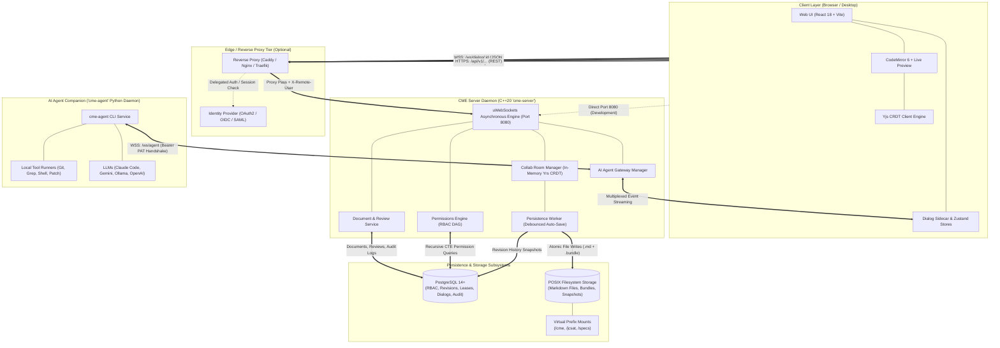
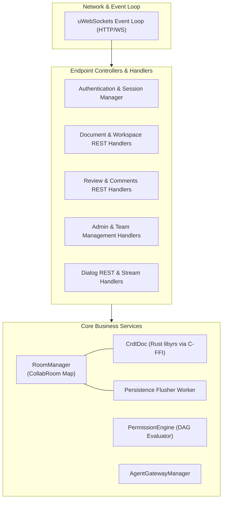
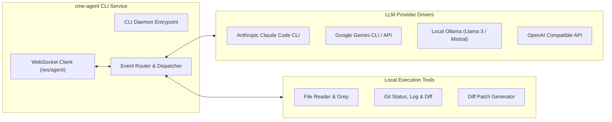
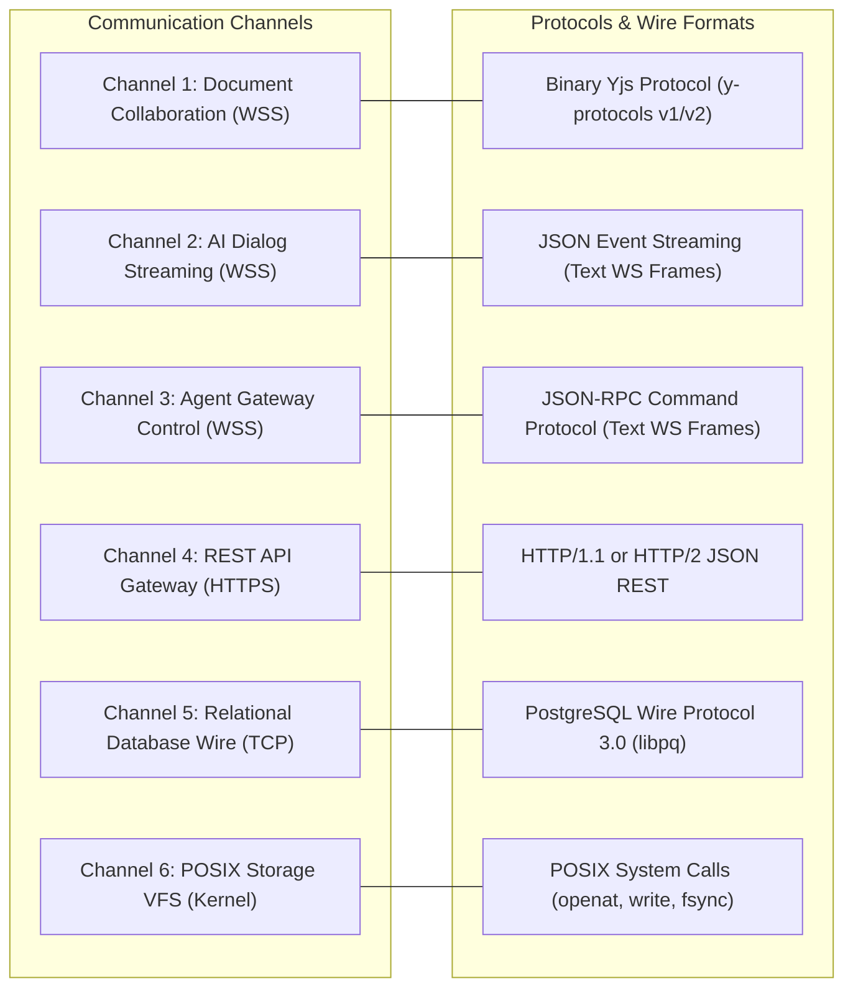
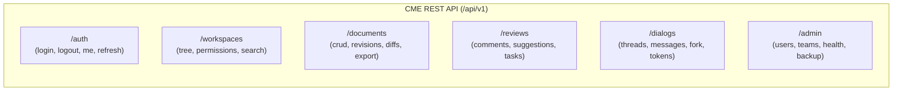
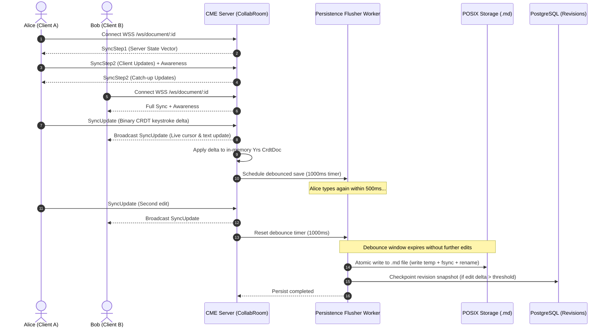
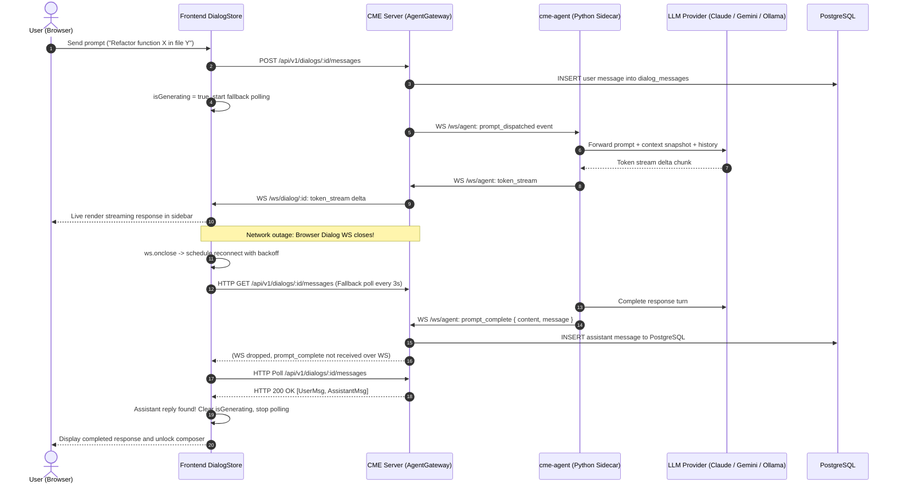
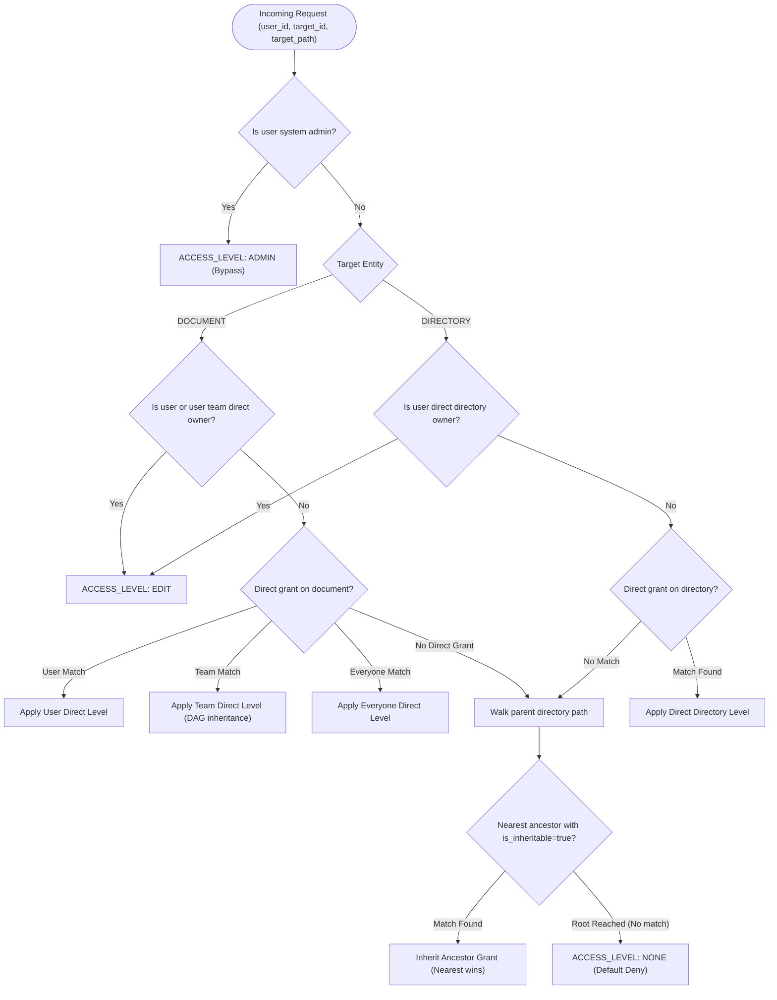

# Collaborative Markdown Editor (CME) Architecture

This document provides a comprehensive technical specification of the runtime architecture, system components, communication channels, wire protocols, and interaction flows governing the **Collaborative Markdown Editor (CME)** platform.

---

## 1. System Overview & Architecture Philosophy

CME is architected as an enterprise-grade, low-latency, real-time collaborative editing platform engineered in C++20 and modern React/TypeScript.

### Core Architectural Principles
* **Local-First & Git-Native**: Markdown files (`.md`) and bundle folders (`.bundle/`) reside directly on the host POSIX filesystem as standard text files, ensuring seamless interoperability with Git repositories, external linters, and command-line tools without proprietary database blob locking.
* **Low-Latency In-Memory Concurrency**: Document collaboration utilizes Conflict-free Replicated Data Types (CRDTs) powered by Rust's `y-crdt` / `yrs` library linked via C-FFI. Collaborative rooms operate entirely in memory on a high-performance C++20 `uWebSockets` event loop, eliminating database round-trips during live keystroke streaming.
* **Dual-Store Persistence**:
  * **POSIX Filesystem**: Stores authoritative markdown content, companion asset bundles, binary CRDT snapshot journals, and soft-delete trash archives.
  * **PostgreSQL (14+)**: Stores relational entities, user identities, password hashes, audit trails, threaded comment discussions, review suggestions, task boards, immutable revision histories, and access control Directed Acyclic Graphs (DAGs).
* **Autonomous AI Agent Gateway**: Built-in real-time WebSocket sidecar bridge enabling AI agents (Anthropic Claude Code, Google Gemini, local Ollama, OpenAI) to run alongside human collaborators with native tool invocation, live streaming diffs, and context attachment.
* **Granular Inheritance & Role-Based Access Control (RBAC)**: Comprehensive permission engine enforcing multi-parent team DAG inheritance via recursive Common Table Expressions (CTEs), directory waterfall inheritance, and superuser administrative overrides.

---

## 2. Global Runtime Architecture

The diagram below illustrates the complete runtime topology, showing client connections, the reverse proxy tier, the core CME server daemon, persistence stores, and the AI agent companion.



---

## 3. Main Runtime Components

### 3.1. Frontend Web Client (React 18 / Vite SPA)

The frontend client runs as a responsive Single Page Application (SPA) executed in modern web browsers. It can be served directly by `cme-server` in embedded UI mode (`--embedded-ui frontend/dist`) or hosted behind a reverse proxy/CDN.

```mermaid
flowchart LR
    subgraph UI_State["Zustand Modular Stores"]
        WS_S["workspaceStore\n(Tabs, Tree, Mounts)"]
        DL_S["dialogStore\n(Messages, Stream, Reconnect)"]
        RV_S["reviewStore\n(Comments, Tasks, Anchors)"]
        UI_S["uiStore\n(Modals, Themes, Panes)"]
        AU_S["authStore\n(User, Tokens, PATs)"]
    end

    subgraph UI_Components["Core UI Components"]
        FT["FileTree & Mounts"]
        EP["EditorPane & Tabs"]
        CE["CollaborativeEditor (CM6)"]
        RP_V["ReaderPage (SSR HTML)"]
        DS_C["DialogSidecar (AI Chat)"]
        ACM["AccessControlModal"]
    end

    subgraph Editor_Engine["CodeMirror 6 Subsystem"]
        Y_CM["y-codemirror.next"]
        LP_P["Live Preview Extension"]
        IR_P["Inline Review & Anchors Plugin"]
        MD_P["Markdown & Math Plugins"]
    end

    UI_State <--> UI_Components
    UI_Components <--> Editor_Engine
```



#### Key Frontend Modules:
1. **Editor Core & Live Preview**: Built on CodeMirror 6 (`@codemirror/lang-markdown`). Supports real-time bidirectional synchronization with Yjs (`y-codemirror.next`), inline decorations, live preview formatting (headings, math with KaTeX, mermaid diagram rendering, task checkboxes, image sizing controls, and wikilinks).
2. **Review & Text Anchoring Subsystem**:
   * Uses precise quote selectors (`createQuoteSelector`) with prefix and suffix context strings to anchor comments and inline suggestions to text blocks.
   * Dynamically tracks edits: as text shifts during collaborative editing, anchored review highlights adjust position automatically.
3. **State Management**: Modular Zustand stores:
   * [`workspaceStore`](file:///home/pasc/cme/frontend/src/stores/workspaceStore.ts): Manages active file tabs, directory navigation, outline hierarchy, and virtual prefix mounts.
   * [`dialogStore`](file:///home/pasc/cme/frontend/src/stores/dialogStore.ts): Manages active AI dialog threads, message history, live streaming tokens, tool activity status, automatic WebSocket reconnection with exponential backoff, tab visibility recovery, and fallback HTTP polling.
   * [`reviewStore`](file:///home/pasc/cme/frontend/src/stores/reviewStore.ts): Coordinates comments, replies, actionable task items, and inline diff proposals.
   * [`authStore`](file:///home/pasc/cme/frontend/src/stores/authStore.ts): Handles session storage, user profile state, login challenges, and session expiry recovery.

---

### 3.2. CME Server Daemon (`cme-server`)

The core server is a native C++20 process engineered for maximum efficiency, sub-millisecond event loop latency, and small memory footprint.



#### Key Server Subsystems:
1. **uWebSockets HTTP/WebSocket Engine**:
   * Runs an asynchronous non-blocking event loop built on `uSockets` (epoll/kqueue).
   * Serves static assets, REST API endpoints, and three distinct real-time WebSocket channels on a single port (default `8080`).
2. **Collaborative Room Manager (`RoomManager` & `CollabRoom`)**:
   * Coordinates in-memory document rooms. Each active document has a single `CollabRoom` holding a `CrdtDoc` (Rust `yrs` CRDT document wrapped via C-FFI).
   * Manages client presence awareness (remote cursors, selections, colors).
   * Debounced Persistence Flusher: Edits accumulate in memory and are asynchronously flushed to POSIX disk after a configurable debounce quiet period (default `1000ms`), preventing disk I/O bottlenecks.
   * Automatic Snapshotting & Eviction: Inactive rooms are serialized into date-partitioned binary CRDT snapshot journals and evicted from RAM. Rooms rehydrate transparently upon the next client connection.
3. **Access Control & Permissions Engine (`PermissionEngine`)**:
   * Implements strict Role-Based Access Control (RBAC) with hierarchical team Directed Acyclic Graphs (DAGs).
   * Evaluates permissions via recursive PostgreSQL Common Table Expressions (CTEs), resolving inherited access, directory inheritance (`is_inheritable = true`), direct document grants, and superuser administrative overrides.
4. **AI Agent Gateway Manager (`AgentGatewayManager`)**:
   * Acts as the real-time multiplexer between developer AI companions (`cme-agent`) connected on `/ws/agent` and browser clients connected to individual dialog threads on `/ws/dialog/:dialog_id`.
   * Tracks in-flight prompts, handles graceful cancellations (`stop_prompt`), detects agent disconnects, and broadcasts fallback failure notifications.
5. **Distributed Instance Leadership Coordinator**:
   * Uses PostgreSQL table `instance_lease` with TTL timestamps and atomic lease acquisition queries (`DELETE FROM instance_lease WHERE expires_at < NOW()`) to ensure single-primary room coordination in multi-node topologies.

---

### 3.3. AI Agent Companion (`cme-agent`)

The `cme-agent` is an autonomous companion daemon written in Python 3.10+ that runs locally on a developer workstation or as a containerized sidecar.



#### Key Agent Capabilities:
1. **Multi-Model Provider Architecture**: Interfaces natively with Anthropic Claude Code, Google Gemini, local Ollama models, or OpenAI.
2. **Autonomous Tool Calling**: Reads workspace files, executes project-wide regex searches, inspects Git commit histories, and generates structured unified diffs (`DiffProposal`).
3. **Secure Handshake**: Authenticates with `cme-server` using Personal Access Tokens (`PAT`) created by users or administrators.
4. **Resilient Streaming**: Streams incremental response tokens, tool execution notifications (`tool_activity`), and proposed document edits directly to the browser via the server's gateway.

---

## 4. Communication Channels, Protocols & Wire Formats

The CME ecosystem utilizes six distinct communication channels and protocols.



---

### Channel 1: Document Collaboration WebSocket

* **Endpoint**: `/ws/document/:document_id`
* **Transport**: WebSocket over TLS (`wss://`) or plaintext (`ws://`)
* **Framing**: Binary ArrayBuffer frames (`uWS::OpCode::BINARY`)
* **Protocol**: Native Yjs Sync Protocol (`y-protocols`)

#### Wire Format & Message Types
Every binary frame begins with a single-byte opcode designating the sub-protocol:

| Opcode | Protocol Name | Direction | Payload Description |
| :--- | :--- | :--- | :--- |
| `0x00` | `SyncStep1` | Client $\leftrightarrow$ Server | Vector clock representing client/server known state |
| `0x01` | `SyncStep2` | Client $\leftrightarrow$ Server | Missing CRDT update blocks sent in response to `SyncStep1` |
| `0x02` | `SyncUpdate` | Client $\leftrightarrow$ Server | Incremental CRDT update frame (live keystroke / formatting change) |
| `0x03` | `Awareness` | Client $\leftrightarrow$ Server | JSON-encoded presence (user cursor position, active selection, color) |
| `0x04` | `Auth` | Client $\rightarrow$ Server | Token authentication handshake frame |

#### Authentication
Handshake is authenticated either via query parameter (`?token=<session_or_pat>`) or browser session cookie (`Cookie: cme_session=<token>`). If reverse-proxy authentication is enabled, the upgrade request is verified via delegated headers.

---

### Channel 2: AI Dialog Streaming WebSocket

* **Endpoint**: `/ws/dialog/:dialog_id`
* **Transport**: WebSocket (`uWS::OpCode::TEXT`)
* **Framing**: UTF-8 JSON text frames
* **Purpose**: Real-time event transport between browser client and CME server for an active AI conversation thread.

#### Server-to-Client Broadcast Events

| Event Type | Payload Attributes | Description |
| :--- | :--- | :--- |
| `token_stream` | `dialog_id`, `delta` | Incremental LLM token chunk for typewriter animation |
| `tool_activity` | `dialog_id`, `tool`, `status` | Agent executing a tool (e.g., `git_status`, `reading_file`) |
| `diff_proposal` | `dialog_id`, `document_id`, `diff` | Unified diff proposed by the agent for inline review |
| `agent_action` | `dialog_id`, `action`, `payload`, `status` | Structured action (e.g., `add_suggestion`, `add_comment`) |
| `prompt_complete` | `dialog_id`, `message` | Complete assistant reply turn finalized and persisted |
| `prompt_stopped` | `dialog_id` | Generation cancelled upon user request |
| `prompt_failed` | `dialog_id`, `error`, `message` | Agent error, failure, or disconnect notice |
| `agent_status` | `online`, `agent_name`, `capabilities` | Live presence status of the user's paired AI agent |
| `dialog_truncated` | `dialog_id` | Conversation thread rolled back to an earlier message |

#### Client-to-Server Commands
* `stop_prompt`: `{ "type": "stop_prompt", "dialog_id": "<id>" }` — Signals the server and agent to halt active generation immediately.

#### Resiliency & Reconnection Protocol
* **Automatic Reconnect**: If the socket closes unexpectedly, the frontend initiates exponential backoff with jitter (`1s` to `15s`).
* **Message Reconciliation**: Upon socket reconnection or browser tab visibility change (`visibilitychange`), the client queries `GET /api/v1/dialogs/:id/messages` and reconciles pending turns. If an assistant message exists in the database, the pending "thinking" state clears immediately.
* **Fallback Polling**: While waiting for an assistant response, the frontend polls `GET /api/v1/dialogs/:id/messages` every 3 seconds to recover replies persisted while the socket was disconnected, enforcing a 90-second timeout.

---

### Channel 3: Agent Gateway Control WebSocket

* **Endpoint**: `/ws/agent`
* **Transport**: WebSocket (`uWS::OpCode::TEXT`)
* **Framing**: Bidirectional UTF-8 JSON text frames
* **Purpose**: Control bus between the local `cme-agent` companion and the CME server.

#### Handshake & Authentication
The agent connects with an HTTP `Authorization: Bearer <agent_pat>` header or `?token=<agent_pat>` query parameter. The server verifies the token against the `agent_tokens` table in PostgreSQL, binding the connection to the token owner's `user_id`.

#### Server-to-Agent Events

```json
{
  "type": "prompt_dispatched",
  "dialog_id": "019488a0-7b24-7123-8901-abcdef012345",
  "prompt": "Can you summarize the performance implications of Yjs binary encoding?",
  "context_snapshot": {
    "document_id": "019488a0-6f11-7444-9999-123456789abc",
    "document_title": "crdt_architecture.md",
    "selected_text": "Binary updates are encoded using lib0 variable-length integers...",
    "line_start": 42,
    "line_end": 58
  },
  "history": [
    { "role": "user", "content": "Hello" },
    { "role": "assistant", "content": "Hi! How can I assist you with your document today?" }
  ]
}
```

#### Agent-to-Server Events
The agent streams execution progress back to the server:
* `token_stream`: Sends incremental token text chunks.
* `tool_activity`: Notifies which tool is currently executing (`tool: "git_diff"`, `status: "executing"`).
* `diff_proposal`: Proposes text replacements as unified diff blocks.
* `agent_action`: Emits structured modifications (`action: "add_comment"`, `action: "direct_edit"`).
* `prompt_complete`: Signals end of turn with full synthesized markdown text.

---

### Channel 4: REST API Gateway

* **Base Path**: `/api/v1/...`
* **Transport**: HTTPS / HTTP/1.1 or HTTP/2
* **Data Format**: `application/json`
* **Authentication**: Pluggable:
  * `Authorization: Bearer <token>` (Personal Access Token or Session Token)
  * `Cookie: cme_session=<token>` (HTTP-only browser session cookie)
  * `X-Remote-User: <username>` & `X-Remote-Email: <email>` (Reverse proxy SSO)

#### Major REST Endpoint Groups:



1. **Authentication (`/api/v1/auth`)**:
   * `POST /login`: Validates credentials, issues session token and sets session cookie.
   * `POST /logout`: Revokes active session token.
   * `GET /me`: Returns authenticated profile, avatar color, and administrative privileges.
2. **Workspaces & Access Control (`/api/v1/workspaces`)**:
   * `GET /tree`: Retrieves hierarchical folder and document tree filtered by user's `READ` permissions.
   * `GET /permissions`: Resolves effective permissions, explicit grants, and inherited provenance for a document or directory.
   * `POST /permissions`: Creates or updates explicit ACL grants (`READ`, `COMMENT`, `EDIT`, `ADMIN`).
   * `DELETE /permissions/:id`: Revokes an explicit ACL grant.
   * `POST /permissions/owner`: Transfers ownership of a document or directory to a user or team.
   * `POST /permissions/test`: Tests effective permissions for any user or team against a node.
3. **Documents & Revisions (`/api/v1/documents`)**:
   * `GET /:id`: Retrieves document content, metadata, and bundle flag.
   * `POST /`: Creates a new document at a target virtual directory path.
   * `PUT /:id`: Saves document content directly.
   * `DELETE /:id`: Moves document to soft-delete trash (`storage_data/trash/`).
   * `GET /:id/revisions`: Lists immutable historical revision snapshots stored in PostgreSQL.
   * `GET /:id/revisions/:rev/diff`: Computes structured unified diff between consecutive revisions.
4. **Review & Task Engine (`/api/v1/reviews`)**:
   * `GET /documents/:id/comments`: Lists threaded comments with exact quote selectors and resolved status.
   * `POST /documents/:id/comments`: Adds a comment anchored to document text.
   * `GET /documents/:id/suggestions`: Lists inline diff suggestions.
   * `POST /documents/:id/suggestions`: Proposes an inline text replacement.
   * `POST /suggestions/:id/apply`: Merges an inline suggestion directly into the active Yjs CRDT room.
   * `GET /tasks`: Lists actionable task items assigned to users or teams.
   * `POST /tasks`: Creates a task with assignee, due date, and priority.
5. **AI Dialogs (`/api/v1/dialogs`)**:
   * `GET /`: Lists user's active dialog threads.
   * `POST /`: Creates a new AI conversation thread.
   * `POST /:id/messages`: Posts a user prompt and triggers agent dispatch.
   * `POST /:id/fork`: Forks a dialog from an earlier message into a new branch.
   * `POST /:id/truncate`: Rolls back a dialog to a specific message ID.
   * `POST /:id/stop`: Halts in-flight prompt generation.
   * `POST /tokens`: Issues a Personal Access Token (`PAT`) for local agent authentication.
6. **System Administration & Health (`/api/v1/admin` & `/api/v1/health`)**:
   * `GET /health`: Unauthenticated health and readiness probe reporting database connectivity, active room counts, and memory usage.
   * `POST /admin/users`: Provisions new user accounts with password hashes and admin flags.
   * `POST /admin/teams`: Creates teams and manages parent-child DAG relationships.
   * `POST /admin/backup/barrier`: Freezes in-memory flushers and yields safe POSIX filesystem point-in-time backup barrier.

---

### Channel 5: Relational Database Wire Protocol

* **Transport**: TCP port `5432`
* **Protocol**: PostgreSQL Frontend/Backend Wire Protocol 3.0
* **Client Driver**: `libpqxx` connection pool (`cme::db::ConnectionPool`)
* **Usage**: Thread-safe pool providing scoped connection checkout (`auto conn = pool->acquire()`). Used for ACID relational transactions, recursive DAG CTE queries, audit log inserts, revision snapshots, and instance lease heartbeats.

---

### Channel 6: POSIX Storage & Filesystem Layer

* **Transport**: Linux Kernel Virtual File System (VFS) System Calls
* **Protocol**: Standard POSIX File API
* **Safety Mechanism**: Crash-resilient atomic writes. The persistence worker writes content to a temporary sibling file (`.filename.tmp.XXXXXX`), flushes dirty pages via `fsync()`, and executes an atomic metadata replacement using `renameat2(..., RENAME_NOREPLACE)` or `rename()`, preventing file truncation or corruption during power loss.

---

## 5. End-to-End Sequence Flows

### 5.1. Real-Time Collaborative Editing & Debounced Persistence

The following diagram illustrates how two browser clients collaborate in real time while the CME server maintains consistency and safely persists to disk and database.



---

### 5.2. AI Assistant Prompt, Streaming & Socket Outage Recovery

This flow illustrates how an AI request is executed by the local companion agent, streamed to the browser, and recovered if the browser WebSocket disconnects during generation.



---

### 5.3. Access Control & ACL Waterfall Evaluation

The permissions engine resolves access rights using a deterministic hierarchical waterfall.



---

## 6. Storage Layout & Directory Structure

CME organizes files on the POSIX filesystem inside `storage_data/`:

```text
storage_data/
├── content/               # Root POSIX storage tree
│   ├── cme/               # Virtual Prefix Mount (/cme)
│   │   ├── README.md
│   │   ├── docs/
│   │   │   └── architecture.md
│   │   └── specs/
│   └── jcsat/             # Virtual Prefix Mount (/jcsat)
│       ├── system_spec.md
│       └── system_spec.bundle/    # Document Companion Bundle
│           ├── diagram.png
│           └── data.csv
├── snapshots/             # Binary Yjs CRDT snapshot journals
│   └── 2026/
│       └── 10/
│           └── doc-019488a0-6f11-7444.bin
├── backups/               # Automated tar.gz backup archives
└── trash/                 # Soft-deleted documents for safe recovery
    └── doc-019488a0-6f11-7444-deleted.md
```

### Document Bundles (`.bundle`)
Documents can be promoted to "Bundle Documents". A companion folder named `<document_name>.bundle/` is created immediately adjacent to the markdown file on disk. Assets (images, diagrams, CSVs, attachments) placed within this folder are served through the server's asset router (`GET /api/v1/documents/:id/assets/:filename`) and participate in access control inheritance.

---

## 7. Security Architecture & Boundary Isolation

1. **Authentication Boundary**:
   * Passwords hashed using standard `bcrypt` with salt rounds.
   * Delegated SSO authentication relies on upstream reverse proxies injecting sanitized identity headers (`X-Remote-User`).
2. **Path Traversal & Sandboxing**:
   * All filesystem operations pass through `normalize_rel_path()` and `is_safe_path()`, strictly forbidding relative path escapes (`../`), null byte injections, and symlink traversals outside mounted workspace roots.
3. **Agent Isolation**:
   * AI agents communicate exclusively over authenticated WebSockets using scoped Personal Access Tokens (`PAT`). Agents cannot bypass database access controls or write outside permitted workspace mounts.
4. **Audit Logging**:
   * All destructive actions (`DELETE_DOCUMENT`, `DELETE_PERMISSION`, `TRANSFER_OWNERSHIP`, `SET_PERMISSION`, `USER_CREATE`, `USER_DELETE`) generate immutable records in the `audit_logs` table capturing timestamp, acting user ID, IP address, user-agent, target node, action result, and JSON parameter diffs.
