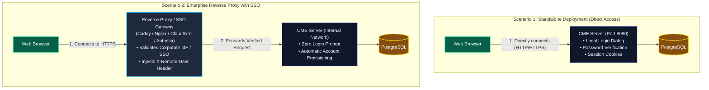
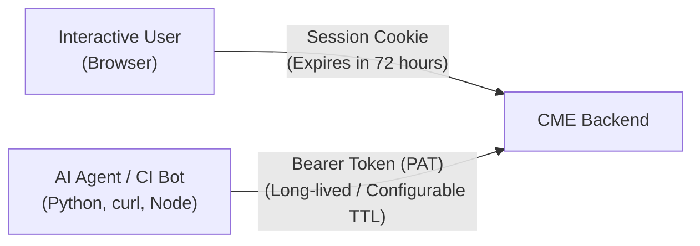
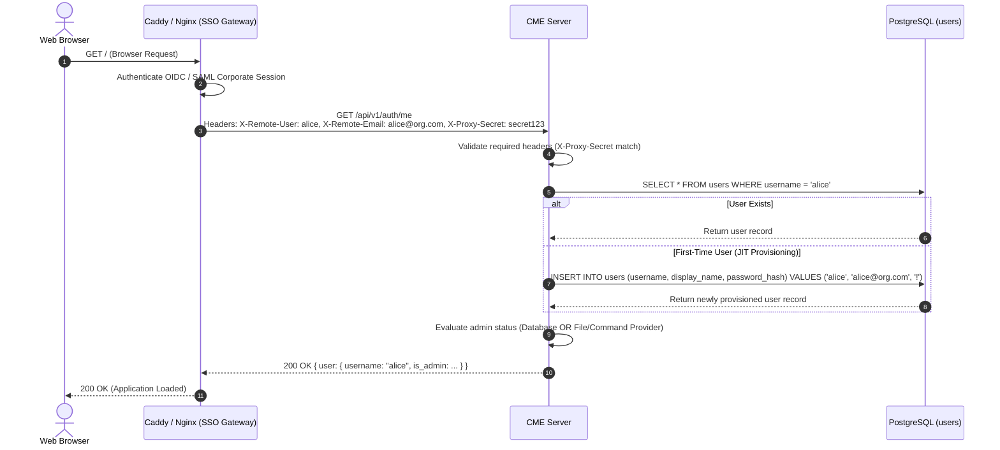
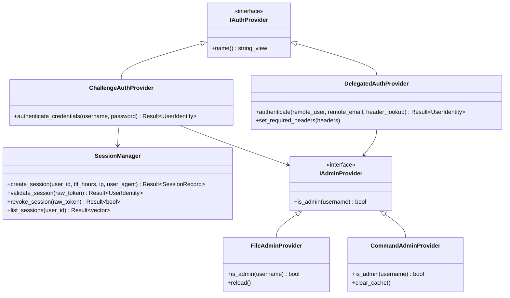

# Authentication & Identity Guide

This document describes the authentication and identity architecture of the **Collaborative Markdown Editor (CME)** platform.

The guide is divided into two parts:
* **Part I: Conceptual & User Guide** — Written for general users, team leads, and system operators. It explains how user identity works, walks through everyday sign-in and token workflows, and provides a clear comparison of deployment scenarios (standalone direct access vs. behind an authenticating reverse proxy).
* **Part II: Technical Architecture & System Reference** — Written for DevOps engineers, security architects, and backend developers. It covers the C++ pluggable authentication engine, cryptographic token generation, reverse-proxy header verification, REST API contracts, and database schema.

---

# Part I: Conceptual & User Guide

## 1. Introduction & Identity Fundamentals

In any collaborative workspace, the system must know **who you are** before it can decide **what you are allowed to see or edit**:

* **Authentication (AuthN)** answers: *"Who is this user?"* (Verifying identity).
* **Authorization (AuthZ)** answers: *"What is this user allowed to do?"* (Enforcing permissions on documents and folders; see [Access Controls](Access%20Controls.md)).

CME supports two distinct ways to establish your identity:
1. **Direct Login (Challenge Credentials)**: You enter a username and password directly into CME's sign-in dialog.
2. **Single Sign-On (Delegated Reverse Proxy)**: Your organization's identity provider (such as Google Workspace, Okta, Microsoft Entra / Azure AD, or Authelia) verifies your identity before you even reach CME. CME trusts the upstream proxy and logs you in automatically.

In both cases, once you are identified, CME creates an active **Session** and can issue **Personal Access Tokens (PATs)** for automated tools and AI agents.

---

## 2. Deployment Scenarios: Behind a Reverse Proxy vs. Standalone

Choosing how to deploy CME depends on your organization's infrastructure, security policies, and team size. CME natively supports both standalone direct operation and delegated enterprise reverse-proxy deployments.



### Scenario 1: Standalone Deployment (Direct Access, No Reverse Proxy)

In this scenario, the CME server runs as a standalone daemon listening directly on an open port (e.g. `http://your-server:8080`).

#### How It Works:
1. When you open CME in your browser, a **Sign In** modal appears requesting your username and password.
2. CME checks your credentials against salted bcrypt password hashes stored in its PostgreSQL database.
3. Upon success, CME sets an encrypted session cookie (`cme_session`) in your browser and stores an authentication token.
4. When you log out, your session cookie is cleared and the token is revoked.

#### Best Used For:
* Small teams and internal office LANs.
* Isolated or air-gapped laboratory networks without corporate Single Sign-On.
* Local developer workstations and evaluation environments.

#### Trade-offs:
* **Advantages**: Minimal infrastructure required. No external proxy or identity provider dependencies; starts up immediately with a single configuration file.
* **Limitations**: Users must remember a separate username and password for CME. TLS/HTTPS certificates must be managed separately if not using a proxy.

---

### Scenario 2: Behind an Authenticating Reverse Proxy (Delegated SSO)

In modern enterprise architectures, CME is placed behind an **Authenticating Reverse Proxy** or **Zero-Trust Access Gateway** (such as Caddy with forward-auth, Nginx with OAuth2-Proxy, Authelia, Authentik, Cloudflare Access, Pomerium, or Tailscale).

#### How It Works:
1. When an employee navigates to `https://cme.company.com`, the reverse proxy intercepts the request.
2. If the user does not have an active corporate session, the proxy redirects them to the company's Identity Provider (e.g., Google Workspace, Okta, or Microsoft Azure AD) for multi-factor authentication (MFA).
3. Once the proxy verifies the user, it forwards the request to the internal CME daemon, injecting trusted HTTP headers:
   * `X-Remote-User`: The verified username handle (e.g., `alice`).
   * `X-Remote-Email`: The user's corporate email address (e.g., `alice@company.com`).
4. **Zero Login Screen**: CME trusts the proxy's assertion. The employee is instantly recognized and taken straight into their workspace—no password prompt, no secondary login.
5. **Just-In-Time (JIT) Provisioning**: If a new team member opens CME for the first time, CME automatically creates their user profile, sets their display name, and generates an avatar color on the fly. Local password login for this account is automatically disabled.

#### Best Used For:
* Enterprise organizations with existing Single Sign-On (OIDC, SAML, or LDAP).
* Zero-trust corporate networks and remote teams using VPNs or identity-aware proxies (Tailscale, Cloudflare Access).
* Environments requiring centralized user de-provisioning (disabling a corporate email instantly cuts off CME access).

#### Trade-offs:
* **Advantages**: Seamless single-click user experience. Enforces corporate MFA and password rotation policies. Eliminates manual onboarding tickets.
* **Security Consideration**: The internal CME port (8080) must be protected so that external users cannot bypass the proxy. To prevent spoofing, CME can be configured to require a shared secret header (`authn.proxy_secret_header`).

---

### Scenario 3: Hybrid Deployment (Browser SSO + API Tokens for Agents)

Many organizations combine both approaches:
* **Interactive Humans** access CME through their web browser via the **Reverse Proxy with SSO**.
* **AI Agents, CI/CD Pipelines, and CLI Scripts** access CME directly via REST APIs or WebSockets by presenting a **Personal Access Token (PAT)** in an `Authorization: Bearer <token>` header, bypassing the SSO login redirect.

---

### Summary Comparison Table

| Feature | Scenario 1: Standalone (Direct) | Scenario 2: Reverse Proxy (Delegated SSO) |
| :--- | :--- | :--- |
| **Authentication Provider** | `challenge` | `delegated` |
| **User Sign-in Experience** | Username & Password modal inside CME | Instant seamless access via Corporate SSO (Google/Okta/Azure) |
| **User Account Creation** | Manually created by Admin via `cme-admin` CLI | Automatic Just-In-Time (JIT) creation on first login |
| **Multi-Factor Auth (MFA)** | Not handled by CME | Enforced by corporate Identity Provider |
| **SSL / TLS Encryption** | External certificate setup or plain HTTP | Terminated automatically by Proxy (Let's Encrypt / Caddy / Nginx) |
| **API & Agent Access** | Personal Access Tokens (PATs) | Personal Access Tokens (PATs) or Proxy Bypass Headers |
| **Best For** | Internal LANs, small teams, air-gapped labs | Enterprise companies, remote teams, compliance environments |

---

## 3. Personal Access Tokens (PATs) & Programmatic Access

While interactive users sign in through the browser, automated systems need long-lived, secure tokens that do not rely on interactive login prompts:



### When to Use Personal Access Tokens:
* **AI Pair-Programming Agents**: Running autonomous code editing or documentation indexing agents (such as the CME Dialog sidecar or external agents).
* **CI/CD Build Pipelines**: Automatically publishing architecture specs or API documentation from Git repositories into CME.
* **Command-Line Tools**: Running migration scripts or syncing documentation via scripts.

### Token Security Best Practices:
* **Treat Tokens Like Passwords**: A token grants the exact same access rights as your personal user account.
* **Audit Active Tokens**: You can view all active sessions and access tokens created under your profile at any time in the CME user interface.
* **Revocation**: If a token is compromised, you can revoke it immediately with a single click, instantly terminating all automated sessions using that token.

---

## 4. Administrator Privileges: How Superusers Are Determined

In CME, a **System Administrator** has superuser privileges: they bypass all document access controls, can inspect all folders, and can assign permissions to any user or team.

CME supports two flexible ways to designate system administrators:

1. **Database Flag (`is_system_admin`)**:
   * Set directly in PostgreSQL or through the `cme-admin user set-admin` command-line utility.
2. **External Admin Provider (Pluggable)**:
   * **File Provider (`admins.txt`)**: CME watches a simple text file listing admin usernames (e.g., `/etc/cme/admins.txt`). If a user's name is in the file, they are automatically granted admin powers. Modifying this file takes effect immediately without restarting the server (**Hot Reload**).
   * **Command Provider (`check_admin.sh`)**: CME executes an external script or queries LDAP/Active Directory to evaluate if a user is an administrator, caching the result in memory for performance.

---

# Part II: Technical Architecture & System Reference

## 5. Authentication Flows & Cryptographic Lifecycle

### Flow A: Challenge-Based Authentication (Local Credentials)

```mermaid
sequenceDiagram
    autonumber
    actor Client as Web Browser
    participant Srv as CME Server
    participant SM as SessionManager
    participant DB as PostgreSQL (users, sessions)

    Client->>Srv: POST /api/v1/auth/login { username, password }
    Srv->>DB: SELECT id, password_hash FROM users WHERE username = $1
    DB-->>Srv: Return user record
    Srv->>Srv: Verify bcrypt($2b$) hash against plaintext password
    alt Password Mismatch
        Srv-->>Client: 401 Unauthorized ("Invalid credentials")
    else Password Match
        Srv->>SM: create_session(user_id, ttl_hours=72)
        SM->>SM: Generate 256-bit cryptorandom token (64 hex characters)
        SM->>SM: Compute SHA-256 digest of token
        SM->>DB: INSERT INTO sessions (token_hash, user_id, expires_at)
        DB-->>SM: OK
        SM-->>Srv: Return raw token & expiration
        Srv-->>Client: 200 OK + Set-Cookie: cme_session=<token>; HttpOnly; SameSite=Lax
    end
```

### Flow B: Delegated Authentication (Reverse Proxy with JIT Provisioning)



### Flow C: WebSocket Authentication (CRDT Collaboration & Real-Time Events)

WebSockets cannot always set custom headers in standard browser JavaScript. CME resolves identities on WebSocket handshakes (`/ws/collab/:doc_id`, `/ws/reviews/:doc_id`, `/ws/dialog/:dialog_id`) via a multi-tier fallback:

1. **Cookie Header**: CME extracts `cme_session=<token>` from the HTTP Upgrade request headers.
2. **Query Parameter**: If cookies are disabled or cross-origin, the client passes `?token=<raw_token>`.
3. **Delegated Headers**: If running behind an authenticating proxy, the upgraded WebSocket inherits `X-Remote-User`.
4. **Validation**: The token is hashed via SHA-256 and verified in PostgreSQL; expired or invalid tokens abort the handshake with HTTP 401.

---

## 6. Cryptography & Security Specifications

### 1. Password Hashing (bcrypt)
* **Algorithm**: `bcrypt` (`$2b$`) with cryptographically generated random salt (work factor $\ge 10$).
* **Storage**: Column `users.password_hash`.
* **Disabled Accounts**: Accounts provisioned via delegated SSO or without password credentials have `password_hash = '!'`. Bcrypt verification always fails safely on `!` hashes.

### 2. Token Generation & Database Storage (OpenSSL)
* **Entropy**: Tokens are generated using OpenSSL `RAND_bytes`, producing 256 bits of cryptographically secure pseudorandom data formatted as a 64-character lowercase hexadecimal string.
* **Storage Invariant**: Plaintext tokens are **never** stored in the database. Only the **SHA-256 digest** (`token_hash`) is persisted in `sessions.token_hash`.
* **Breach Protection**: In the event of a database compromise or backup leak, attackers cannot impersonate active sessions because recovering the plaintext token from a SHA-256 digest is computationally infeasible.

### 3. Cookie Hardening
* **`HttpOnly`**: Prevents client-side JavaScript and Cross-Site Scripting (XSS) vectors from stealing the session token.
* **`SameSite=Lax`**: Defends against Cross-Site Request Forgery (CSRF) on state-changing requests while permitting top-level navigation.
* **`Path=/`**: Restricts the cookie scope to the CME application domain.

---

## 7. Production Reverse Proxy Configurations

### Option A: Caddy Server (Recommended)

Caddy provides automatic HTTPS via Let's Encrypt, seamless WebSocket reverse proxying, and built-in integration with forward-auth proxies (Authelia, Pomerium, Tailscale).

```caddy
# /etc/caddy/Caddyfile
cme.yourcompany.com {
    encode gzip zstd

    # 1. Forward-Auth Gateway (e.g. Authelia, Keycloak Gatekeeper, Pomerium)
    # forward_auth authelia:9091 {
    #     uri /api/verify?rd=https://auth.yourcompany.com
    #     copy_headers Remote-User Remote-Email
    # }

    # 2. Reverse Proxy to CME Daemon
    reverse_proxy 127.0.0.1:8080 {
        header_up Host {host}
        header_up X-Real-IP {remote_host}
        header_up X-Forwarded-For {remote_host}
        header_up X-Forwarded-Proto {scheme}

        # Forward Authenticated Identity Headers
        header_up X-Remote-User {header.Remote-User}
        header_up X-Remote-Email {header.Remote-Email}

        # Shared Secret to Prevent Direct Header Spoofing
        header_up X-Proxy-Secret "cme-cluster-shared-secret-key-98124"
    }
}
```

### Option B: Nginx

```nginx
# /etc/nginx/conf.d/cme.conf
server {
    listen 443 ssl http2;
    server_name cme.yourcompany.com;

    ssl_certificate     /etc/ssl/certs/cme.crt;
    ssl_certificate_key /etc/ssl/private/cme.key;

    # Maximum file upload size (for attachments and images)
    client_max_body_size 64M;

    location / {
        proxy_pass http://127.0.0.1:8080;
        proxy_http_version 1.1;

        # WebSocket Connection Upgrades
        proxy_set_header Upgrade $http_upgrade;
        proxy_set_header Connection "upgrade";

        # Standard Proxy Headers
        proxy_set_header Host $host;
        proxy_set_header X-Real-IP $remote_addr;
        proxy_set_header X-Forwarded-For $proxy_add_x_forwarded_for;
        proxy_set_header X-Forwarded-Proto $scheme;

        # Forwarded Identity from Upstream Auth (e.g. OAuth2-Proxy / Authelia)
        proxy_set_header X-Remote-User $remote_user;
        proxy_set_header X-Remote-Email $http_x_auth_request_email;

        # Anti-Spoofing Shared Secret
        proxy_set_header X-Proxy-Secret "cme-cluster-shared-secret-key-98124";

        # Timeouts for Long-Lived WebSocket Connections
        proxy_read_timeout 86400s;
        proxy_send_timeout 86400s;
    }
}
```

> [!CAUTION]
> **Prevent Header Spoofing**: When using `delegated` authentication, configure CME's `authn.proxy_secret_header` and bind the CME backend only to localhost (`127.0.0.1`) or a private Docker bridge network. Never expose the CME port directly to the public internet if `delegated` mode is enabled without a proxy secret check.

---

## 8. Backend C++ Architecture & Interfaces

The authentication subsystem is implemented under `cme::auth` in [`backend/src/auth/`](file:///home/pasc/cme/backend/src/auth/):



### Core Components:

1. **[`IAuthProvider`](file:///home/pasc/cme/backend/include/cme/auth/auth_provider.hpp)**:
   * Polymorphic interface defining authentication strategies (`challenge` or `delegated`).
2. **[`DelegatedAuthProvider`](file:///home/pasc/cme/backend/src/auth/auth_provider.cpp)**:
   * Extracts user identity from headers, executes validation against configured `required_headers`, and performs Just-In-Time (JIT) provisioning in PostgreSQL.
3. **[`SessionManager`](file:///home/pasc/cme/backend/src/auth/session_manager.cpp)**:
   * Handles cryptorandom token generation, SHA-256 digest hashing, session database insertion, validation waterfalls, and session termination.
4. **[`FileAdminProvider`](file:///home/pasc/cme/backend/src/auth/admin_provider.cpp)**:
   * Parses line-delimited or CSV files of admin usernames. Inspects file `mtime` on requests and hot-reloads dynamically without requiring process restarts.
5. **[`CommandAdminProvider`](file:///home/pasc/cme/backend/src/auth/admin_provider.cpp)**:
   * Executes external verification scripts (e.g., LDAP/AD queries) with sanitized username substitutions and thread-safe in-memory caching.

---

## 9. Configuration Reference (`config.yaml`)

All authentication and authorization behavior can be customized in `config.yaml`:

```yaml
# =============================================================================
# CME Authentication & Authorization Configuration
# =============================================================================

authn:
  # Strategy: 'delegated' (reverse proxy SSO) or 'challenge' (local passwords)
  provider: "delegated"

  # Active session lifetime before expiration (in hours)
  session_ttl_hours: 72

  # Header names forwarded by upstream reverse proxy (delegated mode)
  delegated_header: "X-Remote-User"
  delegated_email_header: "X-Remote-Email"

  # Anti-spoofing security check: Optional shared secret verified between proxy and CME
  proxy_secret_header: "X-Proxy-Secret"
  proxy_secret_value: "cme-cluster-shared-secret-key-98124"

  # Additional required headers that must exist and match for the request to be accepted
  required_headers:
    X-Custom-Auth-Verified: "true"

authz:
  # Strategy for evaluating superuser system administrators: 'file' or 'command'
  admin_provider: "file"

  # Path to text/CSV file listing admin usernames (supports hot reload on change)
  admin_file_path: "/etc/cme/admins.txt"

  # Optional CLI command executed to verify admin status (%USER% placeholder substituted)
  admin_command: "/usr/local/bin/check_admin.sh %USER%"
```

---

## 10. REST API Reference

### 1. `POST /api/v1/auth/login`
Authenticates via username and password, issues a fresh session, and sets a session cookie.

* **Request**:
```json
{
  "username": "alice",
  "password": "SecurePassword123!"
}
```
* **Response (`200 OK`)**:
```json
{
  "token": "613bba18e7b0eda46bb05fcf243b85e2b14bec54a06c8db39fd3894d288bff78",
  "expires_at": "2026-11-03T12:00:00Z",
  "user": {
    "id": "18f987ad-723f-42e1-a083-d3d63b2767a1",
    "username": "alice",
    "display_name": "Alice Engineer",
    "avatar_color": "#3b82f6",
    "is_admin": false
  }
}
```
* **Headers**: `Set-Cookie: cme_session=613bba18...; Path=/; Max-Age=259200; HttpOnly; SameSite=Lax`

---

### 2. `POST /api/v1/auth/logout`
Revokes the current session token in PostgreSQL and clears the client cookie.

* **Headers**: `Authorization: Bearer <token>` or `Cookie: cme_session=<token>`
* **Response (`200 OK`)**:
```json
{
  "status": "logged_out"
}
```
* **Headers**: `Set-Cookie: cme_session=; Path=/; Expires=Thu, 01 Jan 1970 00:00:00 GMT; Max-Age=0; HttpOnly; SameSite=Lax`

---

### 3. `GET /api/v1/auth/me`
Returns the profile, permissions, and effective teams of the current caller.

* **Headers**: `Authorization: Bearer <token>`, `Cookie: cme_session=<token>`, or delegated proxy headers (`X-Remote-User`).
* **Response (`200 OK`)**:
```json
{
  "user": {
    "id": "18f987ad-723f-42e1-a083-d3d63b2767a1",
    "username": "alice",
    "display_name": "Alice Engineer",
    "avatar_color": "#3b82f6",
    "is_admin": true
  },
  "effective_teams": [
    "c8a14b03-5188-466d-a602-5ea59f772591",
    "0f89d41e-6275-4384-8848-18e3881ee25c"
  ]
}
```

---

### 4. `POST /api/v1/auth/tokens`
Generates a new Personal Access Token (PAT) for automated agents and programmatic tools.

* **Request**:
```json
{
  "name": "CI Documentation Sync Bot",
  "ttl_hours": 720
}
```
* **Response (`201 Created`)**:
```json
{
  "token": "49f05a9645ff737604d5e236ceaaee6c230c17ea174b01e389e821b03889146f",
  "expires_at": "2026-12-01T00:00:00Z",
  "user": {
    "id": "18f987ad-723f-42e1-a083-d3d63b2767a1",
    "username": "alice"
  }
}
```

---

### 5. `GET /api/v1/auth/tokens`
Lists all active unexpired tokens and sessions belonging to the caller.

* **Response (`200 OK`)**:
```json
{
  "tokens": [
    {
      "token_hash": "2cf24dba5fb0a30e26e83b2ac5b9e29e1b161e5c1fa7425e73043362938b9824",
      "created_at": "2026-10-31T09:00:00Z",
      "expires_at": "2026-11-30T09:00:00Z",
      "ip_address": "192.168.1.50",
      "user_agent": "CME-AI-Agent/1.0"
    }
  ]
}
```

---

## 11. Database Schema Reference

The authentication and session subsystem is backed by three PostgreSQL tables:

```sql
-- 1. Users Table
CREATE TABLE users (
    id UUID PRIMARY KEY DEFAULT gen_random_uuid(),
    username VARCHAR(128) UNIQUE NOT NULL,
    password_hash VARCHAR(255) NOT NULL, -- bcrypt hash ($2b$) or '!' for delegated SSO
    display_name VARCHAR(255) NOT NULL,
    avatar_color VARCHAR(32) NOT NULL DEFAULT '#3b82f6',
    is_system_admin BOOLEAN NOT NULL DEFAULT FALSE,
    created_at TIMESTAMPTZ NOT NULL DEFAULT NOW(),
    updated_at TIMESTAMPTZ NOT NULL DEFAULT NOW()
);

CREATE INDEX idx_users_username ON users(username);

-- 2. Sessions & Personal Access Tokens
CREATE TABLE sessions (
    token_hash VARCHAR(64) PRIMARY KEY, -- SHA-256 digest of 256-bit token
    user_id UUID NOT NULL REFERENCES users(id) ON DELETE CASCADE,
    expires_at TIMESTAMPTZ NOT NULL,
    created_at TIMESTAMPTZ NOT NULL DEFAULT NOW(),
    ip_address VARCHAR(64),
    user_agent VARCHAR(512)
);

CREATE INDEX idx_sessions_user_id ON sessions(user_id);
CREATE INDEX idx_sessions_expires_at ON sessions(expires_at);

-- 3. Audit Logs (Append-Only)
CREATE TABLE audit_logs (
    id BIGSERIAL PRIMARY KEY,
    user_id UUID REFERENCES users(id) ON DELETE SET NULL,
    action VARCHAR(64) NOT NULL, -- 'LOGIN', 'LOGOUT', 'TOKEN_CREATED', 'TOKEN_REVOKED'
    target_path VARCHAR(1024),
    parameters JSONB,
    status VARCHAR(32) NOT NULL DEFAULT 'SUCCESS',
    ip_address VARCHAR(64),
    user_agent VARCHAR(512),
    created_at TIMESTAMPTZ NOT NULL DEFAULT NOW()
);

CREATE INDEX idx_audit_logs_user ON audit_logs(user_id);
CREATE INDEX idx_audit_logs_created ON audit_logs(created_at);
```

---

## 12. Command-Line Administration (`cme-admin`)

CME ships with the `cme-admin` binary located in `build/bin/cme-admin` (or `/opt/cme/bin/cme-admin` in production installations) for managing users and credentials directly from the host terminal:

```bash
# 1. Create a new user with password credentials
cme-admin user create \
    --username alice \
    --password "SecurePassword123!" \
    --display-name "Alice Engineer" \
    --avatar "#3b82f6"

# 2. Grant superuser administrative privileges
cme-admin user set-admin --username alice

# 3. Revoke superuser administrative privileges
cme-admin user set-admin --username alice --revoke

# 4. Reset a user's password
cme-admin user reset-password --username alice --password "NewPassword456!"

# 5. List all registered users
cme-admin user list

# 6. Delete a user account (cascades sessions and owned documents per policy)
cme-admin user delete --username alice
```
