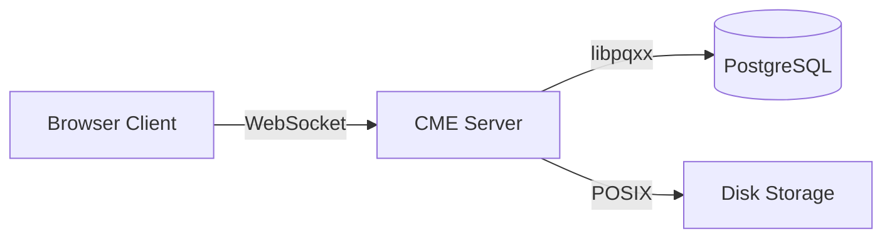
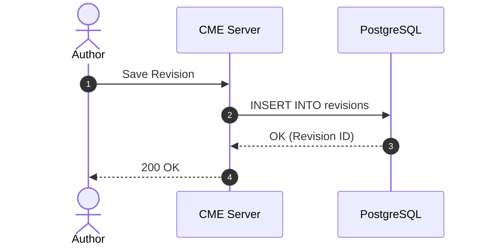
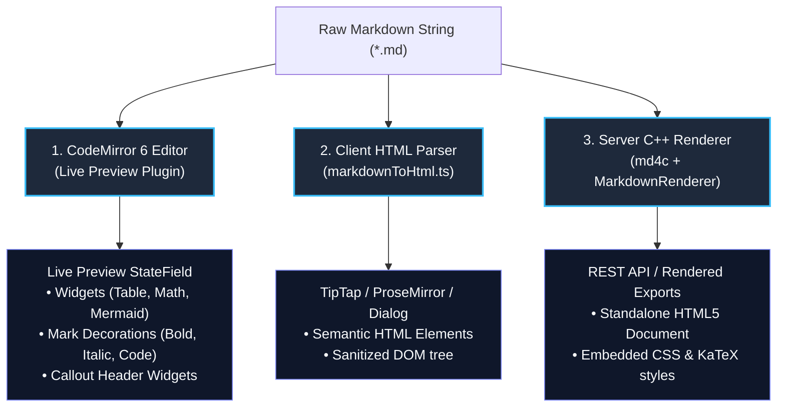

# CME Markdown Syntax & Authoring Guide

This document is the definitive specification and reference manual for all Markdown syntax supported by the **Collaborative Markdown Editor (CME)**.

CME supports a unified superset of **GitHub-Flavored Markdown (GFM)** and **Obsidian** extensions, along with custom visual widgets designed for technical documentation, engineering specifications, and architectural diagrams.

The guide is organized into two parts:
* **Part I: Authoring Guide & Syntax Showcase** — Written for document authors, technical writers, and team members. It provides intuitive examples, visual callouts, and usage tips for everyday writing.
* **Part II: Technical Specifications & Parsing Engine** — Written for developers and tool integrators. It details parser architecture, tokenization rules, escaping invariants, and AST/HTML transformations across CME's frontend and backend renderers.

---

# Part I: Authoring Guide & Syntax Showcase

## 1. Document Structure & Headings

CME supports six levels of standard Markdown headings:

```markdown
# Heading 1 (Document Title)
## Heading 2 (Major Section)
### Heading 3 (Subsection)
#### Heading 4 (Sub-subsection)
##### Heading 5 (Minor Header)
###### Heading 6 (Paragraph Header)
```

### Auto-Generated Anchor Links & Slugs
Every heading automatically generates an anchor slug for direct linking.
* Titles like `## System Overview` generate `#system-overview`.
* Duplicate headings are disambiguated deterministically: `#system-overview-1`, `#system-overview-2`.
* You can link to any heading inside a document: `[Jump to Overview](#system-overview)`.

### Hierarchical Heading Numbering
CME includes a built-in heading numbering engine. When enabled for a document, CME automatically prepends hierarchical numbers:
* `1. Introduction`
* `1.1. Architecture Overview`
* `1.1.1. Storage Engine`

> [!TIP]
> **Outline Navigation**: CME's collapsible sidebar automatically extracts your document's heading tree into an interactive Table of Contents. Clicking any heading in the outline smoothly navigates to that section in both Editor and Reader modes.

---

## 2. Text Formatting & Inline Styling

| Style | Syntax | Example | Result |
| :--- | :--- | :--- | :--- |
| **Bold** | `**text**` or `__text__` | `**Important announcement**` | **Important announcement** |
| *Italic* | `*text*` or `_text_` | `*Draft version*` | *Draft version* |
| ***Bold & Italic*** | `***text***` or `___text___` | `***Crucial milestone***` | ***Crucial milestone*** |
| ~~Strikethrough~~ | `~~text~~` | `~~Deprecated endpoint~~` | ~~Deprecated endpoint~~ |
| `Inline Code` | `` `code` `` | `` `npm run build` `` | `npm run build` |

### Smart Intra-Word Underscores (Snake_case Preservation)
In programming documentation, variable names frequently contain underscores (e.g. `user_id_field`, `MAX_BUFFER_SIZE`). 
* Standard Markdown parsers often misinterpret these as italics (e.g., `user`*`id`*`field`).
* CME's parser intelligently distinguishes snake_case identifiers from intended italics, preserving programming identifiers without requiring backtick escaping.
* Punctuation-wrapped underscores (e.g. `(_italic_)` or `"_italic_"`) continue to italicize as expected.

---

## 3. Links & Cross-References

CME supports three link types: standard web links, relative document paths, and Obsidian-style **WikiLinks**.

### 1. Standard Web & Document Links
```markdown
[CME Website](https://cme.dev)
[Architecture Guide](Architecture.md)
[Permissions Deep Dive](Access%20Controls.md#5-permission-evaluation-waterfall)
```

### 2. Obsidian WikiLinks
WikiLinks allow fast, bidirectional cross-referencing between workspace documents without needing file paths or extensions:

```markdown
[[Architecture]]
[[Access Controls|Security Model]]
[[Architecture#Core Channels|System Channels]]
```

* `[[Document]]`: Automatically resolves to the workspace document named `Document.md`.
* `[[Document|Custom Label]]`: Displays `Custom Label` while navigating to `Document.md`.
* `[[Document#Section]]`: Jumps directly to a specific heading anchor inside the target document.

> [!NOTE]
> **Live Broken Link Detection**: In the CodeMirror editor and Reader view, WikiLinks are evaluated in real time against your workspace tree. Links pointing to valid files appear as blue hyperlinks; broken or missing links are highlighted in amber/rose with a subtle dashed underline.

---

## 4. Images, Diagrams & Media Embeds

### Standard Markdown Images
```markdown


```

### Obsidian Image Embeds with Dimension Resizing
CME supports Obsidian's pipe dimension syntax (`|width` or `|widthxheight`), allowing precise layout control without raw HTML `` tags:

```markdown
<!-- Resize image to 350px width (aspect ratio preserved) -->

![[assets/overview.png|350]]

<!-- Resize image to exact width and height (300px by 200px) -->

![[assets/diagram.png|300x200]]
```

### Document Bundles (`.bundle/`)
When a document is saved as a bundle (e.g. `design_spec/` containing `index.md` and companion assets), images placed in `.bundle/assets/` can be referenced relatively:

```markdown

```

---

## 5. Callouts & GFM Alerts

CME natively renders **GitHub-Flavored Markdown (GFM) Alerts** and **Obsidian Callouts** with custom icons, theme-matched tinted backgrounds, and accent borders.

### Syntax
```markdown
> [!NOTE]
> Highlights information that users should take into account.

> [!TIP]
> Helpful tips and performance recommendations.

> [!IMPORTANT]
> Key information users must know to achieve their goal.

> [!WARNING]
> Urgent info that needs immediate user attention to avoid problems.

> [!CAUTION]
> Advises about risks, destructive actions, or security consequences.
```

### Supported Alert Types & Visual Themes

| Type | Badge Theme | Icon | Standard Usage |
| :--- | :--- | :--- | :--- |
| **`NOTE`** | Blue (`#2563eb`) | Info Circle | Background context, explanations, additional reading. |
| **`TIP`** | Emerald (`#059669`) | Lightbulb | Productivity advice, shortcuts, optimization suggestions. |
| **`IMPORTANT`** | Violet (`#7c3aed`) | Alert Circle | Crucial requirements, required parameters, core invariants. |
| **`WARNING`** | Amber (`#d97706`) | Triangle Alert | Potential breaking changes, deprecation warnings, performance pitfalls. |
| **`CAUTION`** | Red (`#dc2626`) | Shield Alert | High-risk actions, irreversible data loss, security vulnerabilities. |

### Extended Aliases
CME also maps common Obsidian aliases to their canonical theme:
* `[!INFO]`, `[!SEEALSO]`, `[!TODO]` $\longrightarrow$ `NOTE` (Blue)
* `[!HINT]`, `[!SUCCESS]`, `[!CHECK]`, `[!DONE]` $\longrightarrow$ `TIP` (Emerald)
* `[!ATTENTION]` $\longrightarrow$ `IMPORTANT` (Violet)
* `[!WARN]`, `[!FAQ]`, `[!QUESTION]` $\longrightarrow$ `WARNING` (Amber)
* `[!DANGER]`, `[!ERROR]`, `[!FAILURE]`, `[!BUG]` $\longrightarrow$ `CAUTION` (Red)

### Custom Titles
You can supply a custom title directly after the type tag:

```markdown
> [!NOTE] Access Control Philosophy
> CME enforces a strict default-deny authorization waterfall.

> [!WARNING] Breaking Change in v2.0
> Deprecated token headers have been removed from the WebSocket handshake.
```

### Collapsible Folders (Obsidian Syntax)
Add `+` (expanded by default) or `-` (collapsed by default) to create collapsible callouts:

```markdown
> [!NOTE]+ Detailed Architecture Background
> This section is expandable and initially open.

> [!TIP]- Quick Troubleshooting Steps
> This section is collapsed by default to save vertical space.
```

---

## 6. Status Pills & Priority Badges

CME provides a native syntax for inserting clean, colorful status pills and priority badges anywhere in your markdown, including inside table cells:

```markdown
[pill:green|Approved]
[pill:rose|Rejected]
[pill:amber|In Review]
[pill:#7c3aed|VIP Customer]

[status:done]
[status:in-progress]
[status:blocked]

[priority:p0]
[priority:high]
[priority:medium]
[priority:low]
```

### Standard Status & Priority Palettes

| Keyword | Syntax | Color Scheme | Visual Meaning |
| :--- | :--- | :--- | :--- |
| **Done** | `[status:done]` | Emerald Green | Completed action item or resolved state |
| **In Progress** | `[status:in-progress]` | Amber / Orange | Currently active work item |
| **Blocked** | `[status:blocked]` | Rose Red | Blocked on dependency or external blocker |
| **P0 / Urgent** | `[priority:p0]` / `[priority:critical]` | Bold Red | Highest priority; immediate action required |
| **P1 / High** | `[priority:p1]` / `[priority:high]` | Warm Amber | High priority deliverable |
| **P2 / Normal** | `[priority:medium]` / `[priority:low]` | Calm Blue | Standard backlog task |
| **Custom Hex** | `[pill:#2563eb|Custom Label]` | Any hex color | Custom brand or organization tag |

---

## 7. Lists & Interactive Task Checklists

### Unordered & Ordered Lists
```markdown
* Item A
* Item B
  * Sub-item B.1
  * Sub-item B.2

1. First step
2. Second step
3. Third step
```

### Interactive Task Checklists (GFM)
```markdown
- [x] Complete database schema migration
- [x] Implement WebSocket reconnect logic
- [ ] Write integration test suite
- [ ] Deploy to staging cluster
```

* **Live Toggling**: In both the CodeMirror Live Preview and Reader mode, task checkboxes can be clicked directly to toggle their checked state (`[ ]` $\leftrightarrow$ `[x]`).
* In collaborative sessions, checking a task broadcasts the state change to all active room peers in real time.

---

## 8. Tables (GFM Markdown Tables)

CME supports standard GitHub-Flavored Markdown tables with column alignments:

```markdown
| Service Name | Port | Protocol | Status | Health |
| :--- | :---: | :---: | :---: | ---: |
| CME Server | 8080 | HTTP / WS | [status:done] | 100% |
| PostgreSQL | 5432 | TCP (libpq) | [status:done] | 99.9% |
| AI Agent | 9000 | WebSocket | [status:in-progress] | 98.5% |
```

### Alignment Markers:
* `:---` — Left aligned (default for text)
* `:---:` — Centered (ideal for status pills, icons, and dates)
* `---:` — Right aligned (ideal for numbers, percentages, and metrics)

### Interactive Live Table Widget
In the CME Editor, tables are enhanced with an interactive visual widget:
* **Add / Delete Columns & Rows**: Click column/row headers to insert or remove cells.
* **Drag-and-Drop Reordering**: Drag column or row handles to reorganize data intuitively.
* **Direct In-Cell Editing**: Double-click or Tab through cells to update content with automatic Markdown table formatting.

---

## 9. Fenced Code Blocks & Live Code Transclusion

### Syntax Highlighting
Use triple backticks (```` ``` ````) or triple tildes (`~~~`) with a language identifier:

````markdown
```typescript
interface UserProfile {
  id: string;
  username: string;
  displayName: string;
  isAdmin: boolean;
}

export function formatGreeting(user: UserProfile): string {
  return `Welcome back, ${user.displayName}!`;
}
```
````

CME highlights 50+ programming languages via Highlight.js, including TypeScript, JavaScript, Python, C++, Rust, Go, SQL, Bash, HTML, CSS, JSON, and YAML.

### Code Snippet Transclusion (`snippet="..."`)
CME allows you to transclude live source code from your workspace repository directly into documentation:

````markdown
```cpp snippet="backend/src/db/permission_engine.cpp" lines="60-75"
// CME automatically fetches and displays lines 60 through 75
// from permission_engine.cpp directly inside this code block!
```
````

When source files change on disk, CME automatically updates the rendered snippet, keeping documentation permanently in sync with production code.

---

## 10. Diagrams (Mermaid.js)

CME provides first-class support for **Mermaid.js** diagrams embedded directly within markdown fences.

### Flowchart
````markdown

````

### Sequence Diagram
````markdown

````

### Supported Diagram Types:
* Flowcharts (`flowchart TD`, `flowchart LR`)
* Sequence Diagrams (`sequenceDiagram`)
* Class Diagrams (`classDiagram`)
* State Diagrams (`stateDiagram-v2`)
* Entity-Relationship Diagrams (`erDiagram`)
* Git Graphs (`gitGraph`)
* Mindmaps (`mindmap`)
* Gantt Charts (`gantt`)
* Pie Charts (`pie`)
* Quadrant Charts (`quadrantChart`)
* XY Charts (`xychart-beta`)

---

## 11. Mathematics & Formulas (KaTeX / LaTeX)

CME renders mathematical expressions using **KaTeX**, providing fast, typographical formula rendering.

### Inline Math (`$...$`)
Wrap formulas with single dollar signs:
```markdown
The famous mass-energy equivalence equation is $E = mc^2$.
When evaluating Gaussian distributions, the standard integral is $\int_{-\infty}^{\infty} e^{-x^2} dx = \sqrt{\pi}$.
```

### Display / Block Math (`$$...$$`)
Wrap multiline equations with double dollar signs:

```markdown
$$
\oint_C \mathbf{B} \cdot d\mathbf{l} = \mu_0 \left( I_{\text{enc}} + \varepsilon_0 \frac{d\Phi_E}{dt} \right)
$$
```

$$\oint_C \mathbf{B} \cdot d\mathbf{l} = \mu_0 \left( I_{\text{enc}} + \varepsilon_0 \frac{d\Phi_E}{dt} \right)$$

---

# Part II: Technical Specifications & Parsing Engine

## 12. Parser Architecture & Pipeline

CME implements a unified Markdown processing architecture across three runtime subsystems:



### 1. CodeMirror 6 Live Preview (`livePreviewPlugin.ts`)
* Implemented as an incremental `StateField<DecorationSet>` that dynamically generates CodeMirror decorations based on visible viewport lines.
* Operates on cursor proximity: when the cursor enters a styled block (e.g., a callout header or table row), the decoration unfolds into raw Markdown. When the cursor leaves the line, the interactive preview widget replaces the raw syntax.

### 2. Client-Side HTML Parser (`markdownToHtml.ts`)
* Lightweight, zero-dependency Markdown-to-HTML parser used for AI agent chat dialogs, inline review comments, and TipTap editor initialization.
* Strict sanitization to prevent Cross-Site Scripting (XSS).

### 3. Server-Side C++ Renderer (`markdown_renderer.cpp`)
* High-performance C++20 renderer built on `md4c` (Markdown for C, CommonMark + GFM compliant).
* Powers the `/api/v1/documents/:id/rendered` and `/by-path/html` endpoints for headless document export and static viewing.

---

## 13. Lexical Tokenization & Escaping Rules

### 1. Code Span Isolation
Inline code spans (`` `...` `` and ```` ``...`` ````) are masked prior to inline formatting passes:
* Characters like `*`, `_`, `$`, and `|` inside code spans are treated as literal text.
* Status pills like `[pill:blue|label]` inside code blocks are preserved verbatim without rendering into pill widgets.

### 2. Pipe Character Escaping in Tables
Because Markdown tables use the pipe character (`|`) as a column separator, pills, WikiLinks, and math formulas containing pipes inside table cells must be parsed safely:
* In `markdownToHtml.ts` and `markdown_renderer.cpp`, pipes inside pill syntax (`[pill:color|label]`) are escaped prior to table cell splitting, ensuring table columns are not misaligned.
* Literal pipes can be escaped using standard backslashes: `\|`.

### 3. Semicolon & Delimiter Safety in Mermaid Diagrams
In Mermaid sequence diagrams, semicolons (`;`) act as line/statement terminators. Any arrow label containing semicolons (such as HTTP header strings like `Set-Cookie: cme_session=...; HttpOnly; SameSite=Lax`) must omit raw semicolons or enclose parameters in parentheses to prevent syntax parser errors.

---

## 14. HTML Output Specifications

### 1. Callouts / GFM Alerts
```html
<div class="cme-callout cme-callout-note" data-callout="note">
  <div class="cme-callout-title">
    <span class="cme-callout-icon">
      <!-- 18x18 SVG icon -->
    </span>
    <span class="cme-callout-title-text">Access Control Philosophy</span>
  </div>
  <div class="cme-callout-content">
    <p>CME enforces a strict default-deny authorization waterfall.</p>
  </div>
</div>
```

### 2. Status Pills
```html
<span class="cme-pill cme-pill-green" data-color="green">Approved</span>
```

### 3. Mathematics
* **Inline Math**: `<span class="inline-math" data-latex="E = mc^2"></span>` (hydrated by KaTeX)
* **Display Math**: `<div class="katex-display"><span class="katex">...</span></div>`

### 4. Mermaid Diagrams
```html
<div class="mermaid">
flowchart LR
    A --> B
</div>
```

---

## 15. Summary of Markdown Extensions in CME

| Feature | Syntax Example | Extension Origin | CME Support |
| :--- | :--- | :--- | :--- |
| **Heading Anchors** | `## Overview` $\rightarrow$ `#overview` | CommonMark / GFM | Full (Auto-slug + Duplication index) |
| **Hierarchical Numbers** | `1.1. Architecture` | CME Extension | Full (Toggleable per document) |
| **Snake_case Protection** | `snake_case_variable` | CME Extension | Full (No accidental italics) |
| **WikiLinks** | `[[Document\|Label]]` | Obsidian | Full (Live link validator + anchors) |
| **Image Dimensions** | `` | Obsidian | Full (Native aspect ratio preservation) |
| **GFM Alerts / Callouts** | `> [!NOTE] Custom Title` | GFM + Obsidian | Full (All 5 types, aliases, custom titles, fold markers) |
| **Status & Priority Pills** | `[status:done]`, `[priority:p0]` | CME Extension | Full (Pills in text and tables) |
| **Interactive Checklists** | `- [ ] Pending`, `- [x] Done` | GFM | Full (Interactive clicks in Editor & Reader) |
| **Interactive Tables** | `\| Header \|` | GFM | Full (Live column/row reorder & edit widget) |
| **Fenced Code Highlighting** | ```` ```typescript ```` | CommonMark / GFM | Full (50+ languages via Highlight.js) |
| **Code Transclusion** | ```` ```snippet="path" ```` | CME Extension | Full (Dynamic repo sync) |
| **LaTeX Mathematics** | `$E = mc^2$` and `$$...$$` | LaTeX / KaTeX | Full (Inline and display equations) |
| **Diagrams as Code** | \`\`\`mermaid | Mermaid.js | Full (11 diagram types with dark/light themes) |
