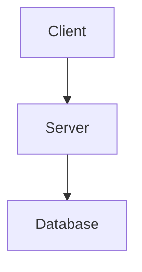

# Server-Side Markdown to Semantic HTML Renderer API

The **Server-Side Markdown to Semantic HTML Renderer** provides server-rendered HTML representations of CME documents. This enables zero-client read-only consumption, automated search engine indexing, archival exports, and high-performance ingestion by external AI agents without requiring a client-side JavaScript headless browser runtime.

---

## 1. Endpoints Overview

| Method | Endpoint | Description | Permission |
| :----- | :------------------------------ | :------------------------------------------------------------------------- | :--------- |
| `GET`  | `/api/v1/documents/:id/html`    | Render document to semantic HTML by its database UUID.                     | `READ`     |
| `GET`  | `/api/v1/documents/by-path/html`| Render document to semantic HTML by relative path (e.g. `?path=guides/intro.md`). | `READ`     |

Both endpoints accept Bearer tokens (`Authorization: Bearer <token>`), session cookies (`session_token`), or delegated identity headers (`X-Remote-User`).

---

## 2. Query Parameters

| Parameter | Type | Default | Description |
| :-------- | :--- | :------ | :---------- |
| `standalone` | `boolean` (`true`/`false`/`1`/`0`) | `false` | When `true`, wraps content in a complete HTML5 document (`<!DOCTYPE html>...`) with embedded Obsidian/GitHub CSS typography, dark/light theme support, KaTeX CSS & scripts, and Mermaid.js ESM loader. |
| `include_reviews` | `boolean` (`true`/`false`/`1`/`0`) | `false` | When `true`, queries PostgreSQL review metadata (active comments, inline edit suggestions, action item tasks) and appends a `<section class="cme-reviews-section">` overlay. |
| `path` | `string` | *(Required for `/by-path/html`)* | Storage-relative filesystem path to the markdown file or bundle. |

---

## 3. Semantic Transforms & Feature Support

The renderer utilizes a vendored, ultra-fast `md4c` CommonMark/GFM engine extended with custom AST callback transforms:

### 3.1. Headings & Anchor Slugs
- Generates clean, deterministic URL anchor slugs:
  ```markdown
  # System Architecture Overview
  ```
  Renders as:
  ```html
  <h1 id="system-architecture-overview">System Architecture Overview</h1>
  ```
- **Collision avoidance**: Duplicate headings within the same document are automatically disambiguated with numeric suffixes (`heading`, `heading-1`, `heading-2`).

### 3.2. KaTeX Mathematical Equations
Converts LaTeX equation spans to standardized KaTeX client hydration markup:
- **Inline equations (`$...$`)**:
  ```markdown
  The mass-energy relation is $E = mc^2$.
  ```
  Renders as:
  ```html
  <p>The mass-energy relation is <span class="katex-inline" data-expr="E = mc^2">$E = mc^2$</span>.</p>
  ```
- **Display equations (`$$...$$`)**:
  ```markdown
  $$
  \int_{-\infty}^{+\infty} e^{-x^2} dx = \sqrt{\pi}
  $$
  ```
  Renders as:
  ```html
  <div class="katex-display" data-expr=" \int_{-\infty}^{+\infty} e^{-x^2} dx = \sqrt{\pi} ">$$ \int_{-\infty}^{+\infty} e^{-x^2} dx = \sqrt{\pi} $$</div>
  ```

### 3.3. Mermaid Diagram Code Blocks
Converts `mermaid` fenced code blocks directly into standard Mermaid DOM containers:
```markdown

```
Renders as:
```html
<div class="mermaid">
graph TD
    Client --&gt; Server
    Server --&gt; Database
</div>
```
When `standalone=true`, the page includes Mermaid ESM auto-initialization (`mermaid.initialize({ startOnLoad: true })`), rendering responsive SVGs automatically in web browsers.

### 3.4. Code Blocks with Syntax Highlighting Metadata
Standard non-Mermaid code blocks preserve syntax language hints for Prism/Shiki/highlight.js:
```markdown
```cpp
int main() { return 0; }
```
```
Renders as:
```html
<pre><code class="language-cpp">int main() { return 0; }</code></pre>
```

### 3.5. Wiki-Style Cross References (`[[...]]`)
Recognizes Obsidian/Roam double-bracket link notation:
- `[[guides/architecture]]` -> links directly to document path.
- `[[guides/architecture|System Overview]]` -> custom display label.
Renders as:
```html
<a class="wiki-link" href="/api/v1/documents/by-path/html?path=guides%2Farchitecture" data-target="guides/architecture">System Overview</a>
```

### 3.6. GitHub-Flavored Markdown (GFM) Tables
Supports table alignment indicators:
```markdown
| Method | Endpoint | Access |
| :----- | :------: | -----: |
| GET    | `/api`   | Read   |
```
Renders as:
```html
<table>
<thead>
<tr>
<th align="left">Method</th>
<th align="center">Endpoint</th>
<th align="right">Access</th>
</tr>
</thead>
<tbody>
<tr>
<td align="left">GET</td>
<td align="center"><code>/api</code></td>
<td align="right">Read</td>
</tr>
</tbody>
</table>
```

### 3.7. Task Lists
Renders disabled interactive checkboxes:
```markdown
- [x] Schema migration applied
- [ ] Deploy server
```
Renders as:
```html
<ul>
<li class="task-list-item"><input type="checkbox" disabled class="task-list-item-checkbox" checked="" /> Schema migration applied</li>
<li class="task-list-item"><input type="checkbox" disabled class="task-list-item-checkbox" /> Deploy server</li>
</ul>
```

---

## 4. Review Subsystem Overlay (`?include_reviews=true`)

When requested, the renderer queries active comments, edit suggestions, and action items from PostgreSQL and renders a structured review overlay section:

```html
<section class="cme-reviews-section">
  <h3 id="cme-reviews-heading">Reviews &amp; Comments</h3>
  <div class="cme-reviews-subgroup cme-comments-group">
    <h4>Comments (1)</h4>
    <div class="cme-review-item cme-comment-item" data-id="c0a801-...">
      <div class="cme-review-header">
        <span class="cme-review-author">Alice Engineer (@alice)</span>
        <span class="cme-review-badge cme-status-OPEN">OPEN</span>
      </div>
      <div class="cme-review-content">Should we add a redis cache here?</div>
    </div>
  </div>
  <div class="cme-reviews-subgroup cme-suggestions-group">
    <h4>Suggestions (1)</h4>
    <div class="cme-review-item cme-suggestion-item" data-id="s0b902-...">
      <div class="cme-review-header">
        <span class="cme-review-author">Bob Reviewer (@bob)</span>
        <span class="cme-review-badge cme-status-PENDING">PENDING</span>
      </div>
      <div class="cme-diff-view">
        <del class="cme-diff-del">slow performance</del>
        <ins class="cme-diff-ins">sub-millisecond latency</ins>
      </div>
    </div>
  </div>
</section>
```

---

## 5. Security & XSS Sanitization

To ensure complete safety when serving documents authored by multiple collaborative users:
1. **Raw HTML Blocks & Spans**: All raw HTML tags (`<script>`, `<iframe>`, `onload=`, etc.) embedded within markdown content are safely entity-escaped (`&lt;script&gt;`).
2. **Attribute Values**: URLs, link titles, image sources, and `data-expr` attributes are strictly sanitized and attribute-escaped.
3. **Task Checkboxes**: Rendered with the `disabled` attribute to prevent unauthorized form submission exploits.

---

## 6. Verification Examples

### Standalone HTML Document
```bash
curl -s -H "Authorization: Bearer $TOKEN" \
  "http://localhost:8080/api/v1/documents/$DOC_ID/html?standalone=true" | grep -E "<html>|<h1"
```

### Semantic HTML Fragment with Reviews
```bash
curl -s -H "Authorization: Bearer $TOKEN" \
  "http://localhost:8080/api/v1/documents/by-path/html?path=guides/intro.md&include_reviews=true"
```
