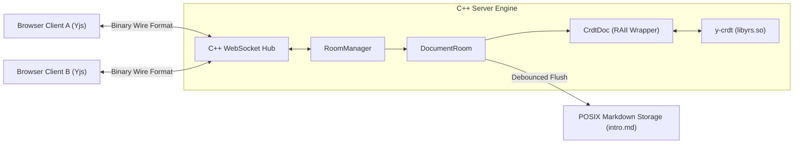

# Native Yjs CRDT C-FFI Integration Specification

The Collaborative Markdown Editor (CME) platform utilizes Conflict-free Replicated Data Types (CRDTs) for real-time document synchronization across web browser clients and automated agents. Rather than running a heavyweight Node.js sidecar service, CME directly integrates the native Yjs core engine (**`y-crdt` / `yrs`** v0.28.0) via C-FFI (`libyrs`) into the multi-threaded C++23 server daemon.

---

## Architectural Objectives

1. **Zero-Overhead Memory Coordination:** In-memory `YDoc` instances run inside the C++ server process, eliminating IPC overhead, serialization bottlenecks, and Node.js process management.
2. **Wire Protocol Compatibility:** Native binary compatibility with the standard Yjs browser client ecosystem (`yjs`, `y-websocket`, `@tiptap/extension-collaboration`).
3. **Decoupled Persistence:** In-memory CRDT deltas converge deterministically and are debounced and serialized to POSIX Markdown files without holding blocking locks.

---

## Component Architecture

---

## C++23 Abstractions

### 1. `cme::collab::CrdtDoc`
RAII container wrapping an underlying `YDoc*` pointer:
* **Text Operations:** `get_text(name)`, `insert_text(index, text)`, `delete_text(index, length)`, `set_text(text)`.
* **State Vector Generation (`SyncStep1`):** Calls `ytransaction_state_vector_v1` to extract a compact lib0 v1 binary representation of local clock states across all client IDs.
* **Differential Delta Extraction (`SyncStep2`):** Calls `ytransaction_state_diff_v1` against a remote state vector to compute only missing updates.
* **Update Ingestion:** Calls `ytransaction_apply` to apply binary updates atomically.

### 2. `cme::collab::DocumentRoom`
Thread-safe collaborative session manager:
* Manages an active `CrdtDoc` protected by `std::mutex`.
* Tracks connected peer presence (`PeerInfo`: `client_id`, `username`, `display_name`, `avatar_color`).
* Maintains dirty-state tracking (`is_dirty_`, `last_edit_time_`, `last_flush_time_`) for debounced filesystem writes.

### 3. `cme::collab::RoomManager`
Thread-safe coordinator for active in-memory rooms:
* `get_or_create_room(doc_id, initial_content, fs_path)`: Lazily creates or returns active room.
* `get_room(doc_id)`: Look up active room.
* `remove_room(doc_id)`: Evicts room from memory once all peers disconnect and room is clean.
* `get_dirty_rooms()`: Returns rooms with unflushed edits for periodic persistence workers.

---

## Binary Synchronization Lifecycle

1. **Client Handshake (`SyncStep1`):**
   * Client connects to `/ws/collab/:doc_id` and transmits its local state vector.
   * Server receives client state vector $SV_{client}$.
2. **Server Delta Reply (`SyncStep2`):**
   * Server executes `room->compute_sync_step2(SV_client)`.
   * Server responds with the binary delta containing all updates known to the server that the client is missing.
3. **Client Delta Push:**
   * Client transmits its missing updates to the server.
   * Server executes `room->apply_client_update(delta)`.
   * Server marks room as dirty and broadcasts delta to all other connected room peers.

---

## Verification & Conflict-Free Convergence

The test suite in [`ycrdt_cffi_integration_test.cpp`](file:///home/pasc/cme/tests/backend/ycrdt_cffi_integration_test.cpp) validates:
* Two-party bidirectional synchronization (`SyncStep1` $\to$ `SyncStep2`).
* Simultaneous, out-of-order concurrent editing between independent `DocumentRoom` instances arriving at 100% identical converged string content.
* Three-peer diamond CRDT network reconciliation.
* Thread-safe `RoomManager` coordination and dirty querying.
