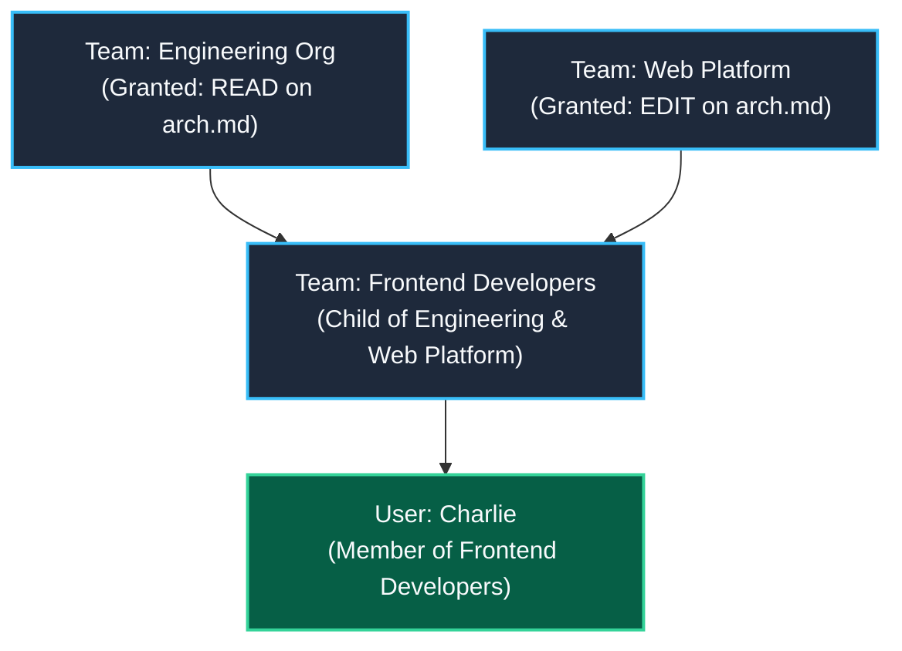
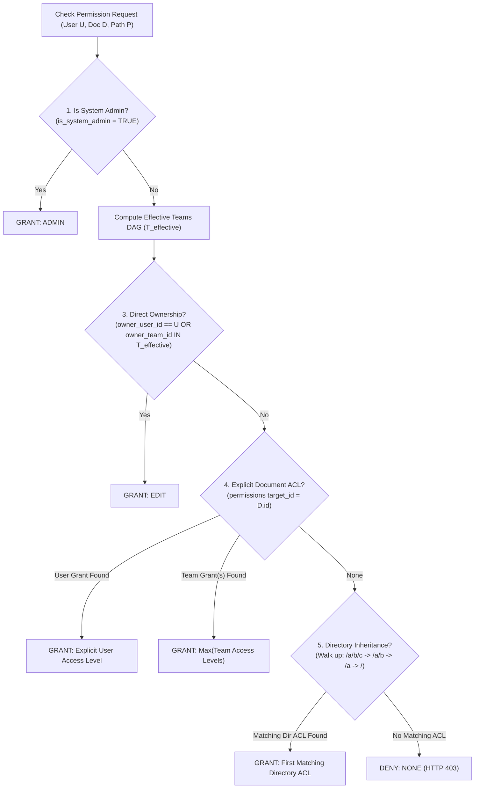

# Multi-Parent Team DAG & Permission Engine

## Motivation & Architecture

In traditional enterprise permissions systems, teams are often restricted to single-parent tree hierarchies (e.g. `engineering -> backend -> core`). In modern organizations, teams are cross-functional: a developer may belong to `frontend-devs`, which simultaneously belongs to both `engineering` (functional org) and `web-platform` (project org).

To reflect this reality, CME models teams as a **Directed Acyclic Graph (DAG)** using the `team_parents` table:



When Charlie requests access to `arch.md`, the permission engine transitively resolves all ancestor teams in the DAG, aggregating granted permissions.

---

## 1. Transitive Team Traversal (Recursive CTE)

Given a `user_id`, PostgreSQL resolves the complete set of effective teams using `WITH RECURSIVE`:

```sql
WITH RECURSIVE effective_teams AS (
    -- 1. Base case: Direct team memberships
    SELECT team_id
    FROM team_members
    WHERE user_id = $1::uuid

    UNION

    -- 2. Recursive step: Transitive parent team traversal
    SELECT tp.parent_team_id
    FROM team_parents tp
    JOIN effective_teams et ON tp.child_team_id = et.team_id
)
SELECT team_id::text FROM effective_teams;
```

### Properties of this query:
* **Arbitrary Depth:** Traverses any depth of ancestor teams.
* **Cycle Safety:** Handled by `UNION` (which deduplicates visited team UUIDs, preventing infinite loops in graph traversals) and the constraint `CHECK (parent_team_id <> child_team_id)`.
* **High Performance:** Backed by indices on `team_members(user_id)` and `team_parents(child_team_id)`.

---

## 2. Granular Permission Resolution Hierarchy

When a user attempts an operation on a document `D` located at path `P`, `cme::db::PermissionEngine::check_permission()` evaluates access according to this strict priority waterfall:



### Cumulative Access Levels
Permissions follow a cumulative hierarchy:
1. `ADMIN` (4): Full administrative rights, document deletion, and ACL management.
2. `EDIT` (3): Edit document markdown, upload attachments, resolve tasks, and accept suggestions.
3. `COMMENT` (2): Leave comments, submit edit suggestions, and check assigned tasks. Read markdown.
4. `READ` (1): Read markdown content and view media assets.
5. `NONE` (0): Denied.

---

## 3. Test Verification (`db_permissions_dag_test`)

The integration test in `tests/backend/db_permissions_dag_test.cpp` validates these exact cases:
1. **Diamond DAG Inheritance:** Charlie inherits `READ` from `engineering` and `EDIT` from `web-platform`. Evaluates to `EDIT` on `arch.md`.
2. **Direct Team Scope:** `frontend-devs` has `COMMENT` on `styleguide.md`. Evaluates to `COMMENT`.
3. **Default Deny:** Document `secret.md` has no grants. Evaluates to `NONE`.
4. **Superuser Bypass:** Admin user has `ADMIN` on all documents.
5. **Document Ownership:** Documents owned by Charlie grant implicit `EDIT`.
6. **Directory Inheritance:** Inherited `READ` on `/test/shared/guides/intro.md` from directory grant on `/test/shared`.
