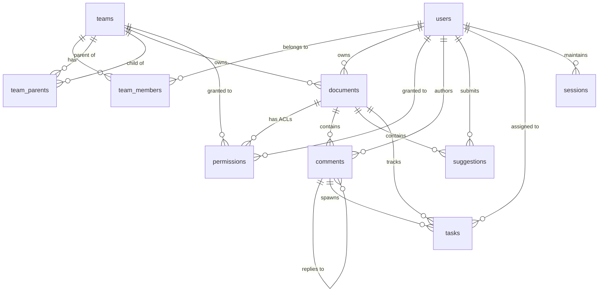

# Relational Database Schema Specification

PostgreSQL 16+ is used as the relational persistence layer for user identities, DAG team hierarchies, document ACLs, active sessions, and review metadata (comments, suggestions, and tasks).

## Entity-Relationship Model

---

## Tables & Column Definitions

### 1. `schema_migrations`
Tracks versioned database migrations applied by `cme-migrate`.
* `version` (`INT`, PK): Incremental integer migration version.
* `name` (`VARCHAR(255)`, NOT NULL): Human-readable migration script identifier.
* `applied_at` (`TIMESTAMPTZ`, DEFAULT `NOW()`): Timestamp when migration was executed.

### 2. `users`
Stores user authentication credentials, display styling, and administrative flags.
* `id` (`UUID`, PK, DEFAULT `gen_random_uuid()`): Immutable unique user identifier.
* `username` (`VARCHAR(64)`, UNIQUE, NOT NULL): Login username.
* `password_hash` (`VARCHAR(255)`, NOT NULL): Argon2id / bcrypt password hash.
* `display_name` (`VARCHAR(128)`, NOT NULL): Name displayed in remote cursor badges.
* `avatar_color` (`VARCHAR(7)`, DEFAULT `'#3b82f6'`): Hex color code assigned to cursor and selection carets.
* `is_system_admin` (`BOOLEAN`, DEFAULT `FALSE`): Superuser flag that bypasses all document/directory ACLs.
* `created_at` (`TIMESTAMPTZ`, DEFAULT `NOW()`): Account creation timestamp.
* `updated_at` (`TIMESTAMPTZ`, DEFAULT `NOW()`): Account update timestamp.

### 3. `teams`
Groups of users for collaboration and access control.
* `id` (`UUID`, PK, DEFAULT `gen_random_uuid()`): Unique team identifier.
* `name` (`VARCHAR(128)`, UNIQUE, NOT NULL): Unique team name.
* `description` (`TEXT`): Optional description of the team's scope.
* `created_at` (`TIMESTAMPTZ`, DEFAULT `NOW()`): Team creation timestamp.

### 4. `team_members`
Junction table mapping users to teams.
* `team_id` (`UUID`, FK `teams.id` ON DELETE CASCADE): Team reference.
* `user_id` (`UUID`, FK `users.id` ON DELETE CASCADE): User reference.
* `role` (`VARCHAR(32)`, DEFAULT `'member'`): Role within the team (`'member'`, `'admin'`).
* **Primary Key:** `(team_id, user_id)`.

### 5. `team_parents` (Multi-Parent Team DAG)
Models a Directed Acyclic Graph (DAG) of team memberships where child teams can inherit from multiple parent teams simultaneously.
* `parent_team_id` (`UUID`, FK `teams.id` ON DELETE CASCADE): Parent team identifier.
* `child_team_id` (`UUID`, FK `teams.id` ON DELETE CASCADE): Child team identifier.
* **Primary Key:** `(parent_team_id, child_team_id)`.
* **Constraint:** `CHECK (parent_team_id <> child_team_id)` (prevents direct self-reference cycles).

### 6. `documents`
Registry mapping storage filesystem paths to immutable document UUIDs.
* `id` (`UUID`, PK, DEFAULT `gen_random_uuid()`): Stable document identifier.
* `fs_path` (`TEXT`, UNIQUE, NOT NULL): Relative path within storage directory (`engineering/spec.md`).
* `title` (`VARCHAR(255)`, NOT NULL): Cached title extracted from top heading or filename.
* `owner_user_id` (`UUID`, NULLABLE, FK `users.id` ON DELETE SET NULL): Owning user.
* `owner_team_id` (`UUID`, NULLABLE, FK `teams.id` ON DELETE SET NULL): Owning team.
* `created_at` (`TIMESTAMPTZ`, DEFAULT `NOW()`): Document creation timestamp.
* `updated_at` (`TIMESTAMPTZ`, DEFAULT `NOW()`): Last modification timestamp.

### 7. `permissions`
Granular Access Control List (ACL) entries for documents and directory trees.
* `id` (`BIGSERIAL`, PK): Sequential permission ID.
* `target_type` (`VARCHAR(16)`, NOT NULL): Resource target (`'DOCUMENT'` or `'DIRECTORY'`).
* `target_id` (`UUID`, NULLABLE, FK `documents.id` ON DELETE CASCADE): Document reference when `target_type = 'DOCUMENT'`.
* `directory_path` (`TEXT`, NULLABLE): Directory prefix when `target_type = 'DIRECTORY'` (`'engineering/specs'`).
* `grantee_type` (`VARCHAR(16)`, NOT NULL): Grant recipient type (`'USER'` or `'TEAM'`).
* `grantee_id` (`UUID`, NOT NULL): Grantee UUID referencing `users.id` or `teams.id`.
* `access_level` (`VARCHAR(16)`, NOT NULL): Access scope (`'READ'`, `'COMMENT'`, `'EDIT'`, `'ADMIN'`).
* **Constraint:** Enforces that document targets specify `target_id` and directory targets specify `directory_path`.

### 8. `comments`
Threaded discussion comments anchored to document text spans.
* `id` (`UUID`, PK, DEFAULT `gen_random_uuid()`): Unique comment ID.
* `document_id` (`UUID`, FK `documents.id` ON DELETE CASCADE): Associated document.
* `parent_id` (`UUID`, NULLABLE, FK `comments.id` ON DELETE CASCADE): Parent comment for threaded replies.
* `author_id` (`UUID`, FK `users.id` ON DELETE CASCADE): Comment author.
* `content` (`TEXT`, NOT NULL): Markdown comment text.
* `status` (`VARCHAR(16)`, DEFAULT `'OPEN'`): Thread status (`'OPEN'` or `'RESOLVED'`).
* `anchor` (`JSONB`, DEFAULT `'{}'::jsonb`): Dual-anchoring coordinate metadata (`from_offset`, `to_offset`, `prefix`, `exact`, `suffix`).
* `created_at`, `updated_at` (`TIMESTAMPTZ`, DEFAULT `NOW()`).

### 9. `suggestions`
Inline text replacement proposals.
* `id` (`UUID`, PK, DEFAULT `gen_random_uuid()`): Unique suggestion ID.
* `document_id` (`UUID`, FK `documents.id` ON DELETE CASCADE): Associated document.
* `author_id` (`UUID`, FK `users.id` ON DELETE CASCADE): Proposer.
* `status` (`VARCHAR(16)`, DEFAULT `'PENDING'`): Status (`'PENDING'`, `'ACCEPTED'`, `'REJECTED'`).
* `original_text` (`TEXT`, NOT NULL): Existing text targeted for replacement.
* `suggested_text` (`TEXT`, NOT NULL): Proposed replacement text.
* `anchor` (`JSONB`, DEFAULT `'{}'::jsonb`): Text coordinate boundaries and context quotes.
* `created_at` (`TIMESTAMPTZ`, DEFAULT `NOW()`), `resolved_at` (`TIMESTAMPTZ`, NULLABLE).

### 10. `tasks`
Action item checklists created independently or within comment threads.
* `id` (`UUID`, PK, DEFAULT `gen_random_uuid()`): Unique task ID.
* `document_id` (`UUID`, FK `documents.id` ON DELETE CASCADE): Associated document.
* `comment_id` (`UUID`, NULLABLE, FK `comments.id` ON DELETE SET NULL): Optional parent discussion thread.
* `description` (`TEXT`, NOT NULL): Task description.
* `assignee_id` (`UUID`, NULLABLE, FK `users.id` ON DELETE SET NULL): Assigned user.
* `is_completed` (`BOOLEAN`, DEFAULT `FALSE`): Completion flag.
* `due_date` (`TIMESTAMPTZ`, NULLABLE): Optional deadline.
* `created_at` (`TIMESTAMPTZ`, DEFAULT `NOW()`), `completed_at` (`TIMESTAMPTZ`, NULLABLE).

### 11. `sessions`
Authentication sessions and Personal Access Tokens (PATs).
* `token_hash` (`VARCHAR(64)`, PK): SHA-256 hash of the bearer token or session cookie value.
* `user_id` (`UUID`, FK `users.id` ON DELETE CASCADE): Authenticated user.
* `ip_address` (`INET`, NULLABLE): Client IP address.
* `user_agent` (`TEXT`, NULLABLE): Browser / client identification string.
* `expires_at` (`TIMESTAMPTZ`, NOT NULL): Token expiry deadline.
* `created_at` (`TIMESTAMPTZ`, DEFAULT `NOW()`).
