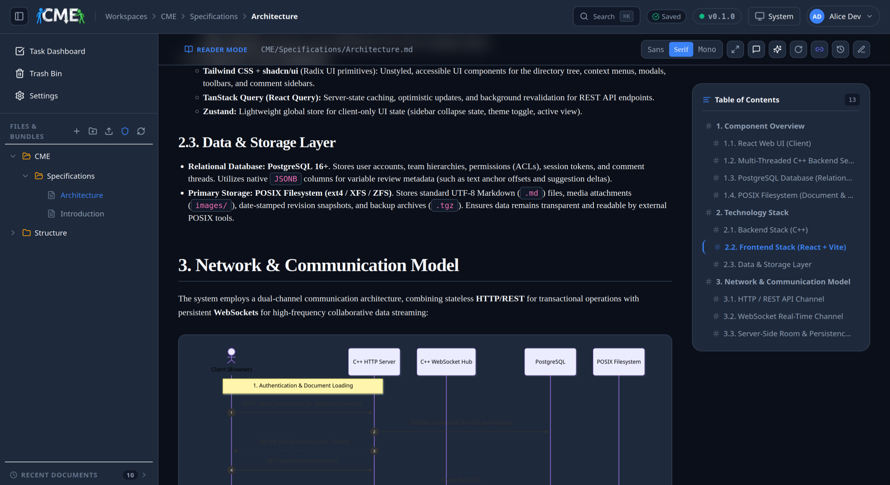
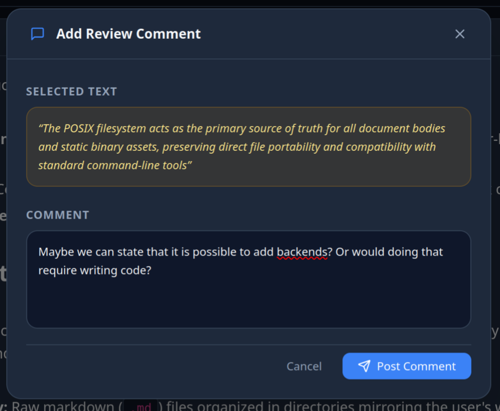
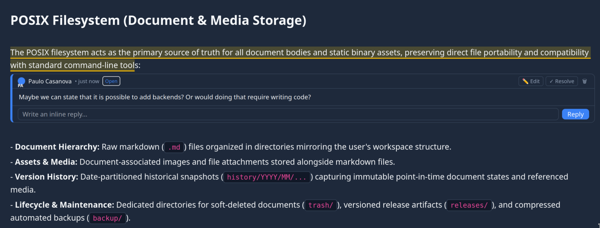
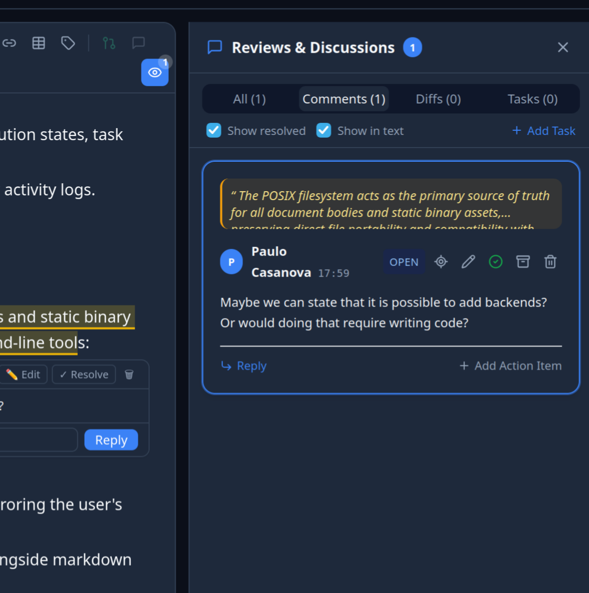
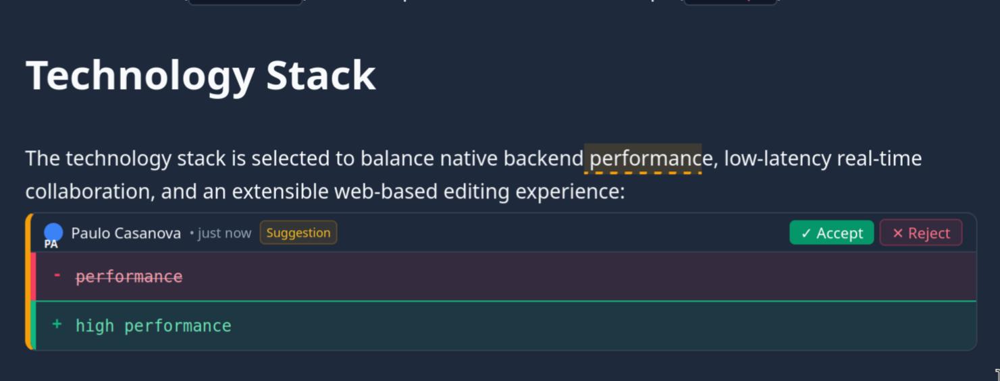
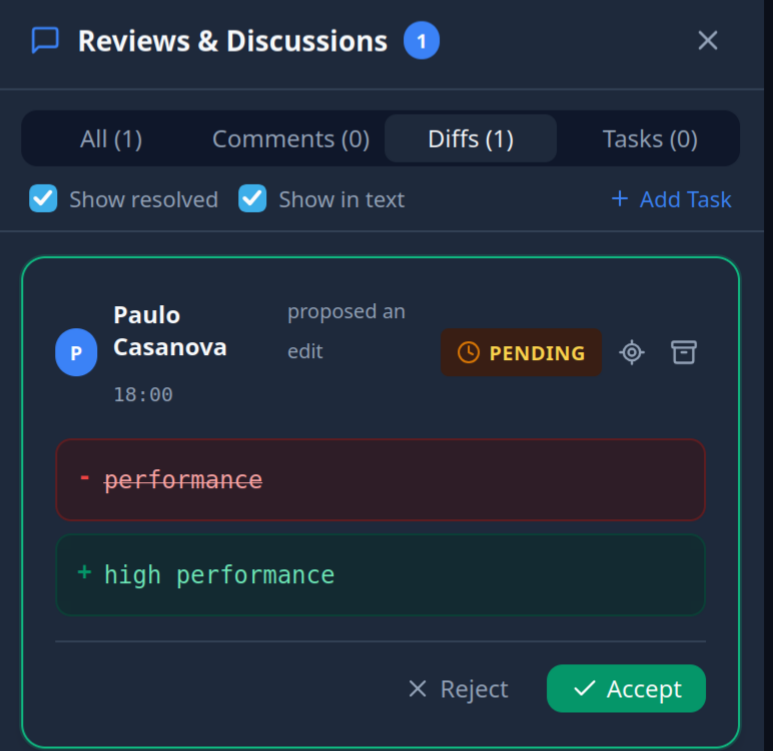
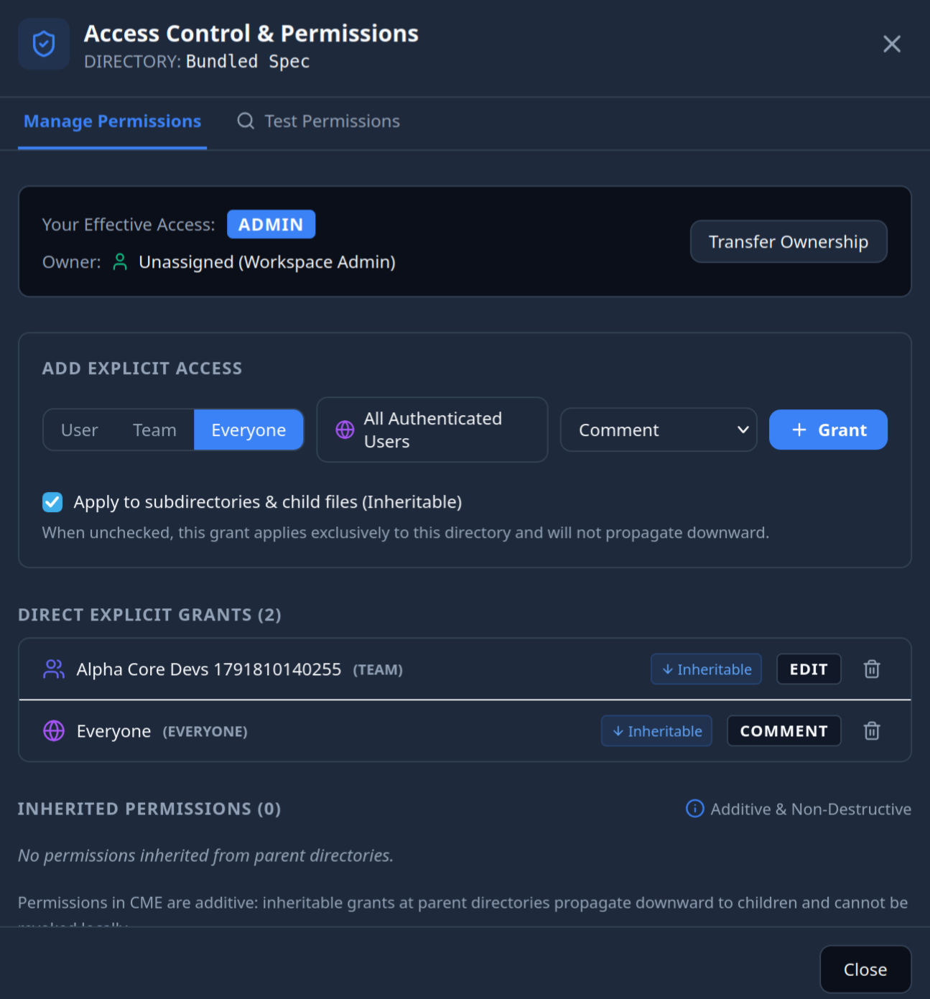
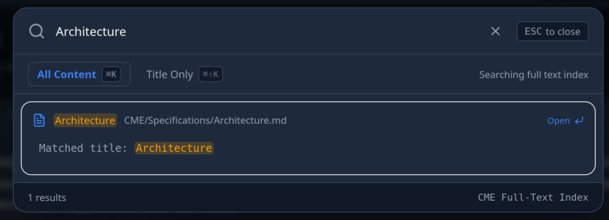
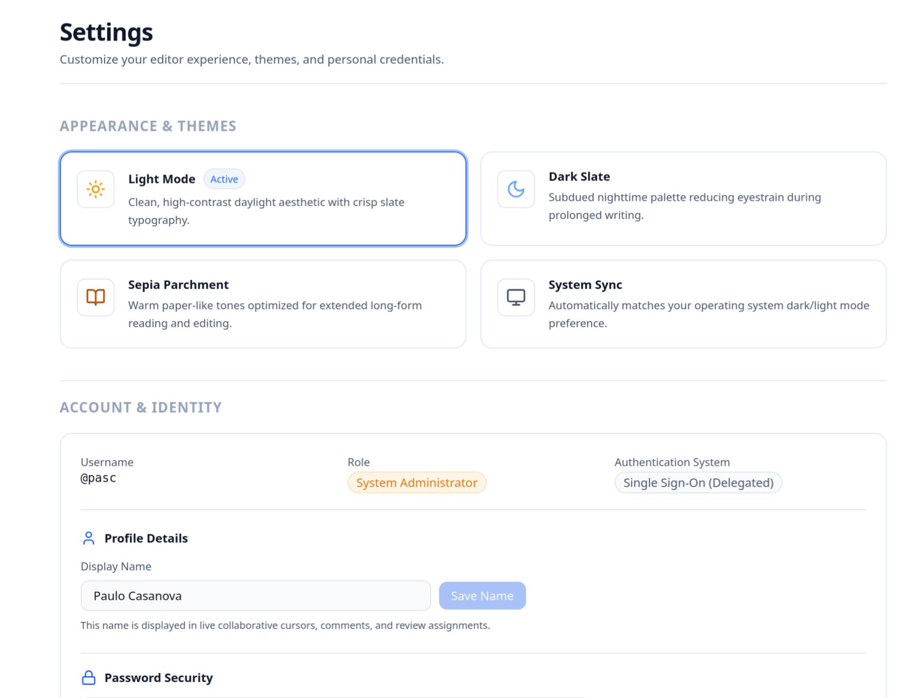

# Collaborative Markdown Editor (CME)

> **The modern collaborative knowledge platform that keeps your documentation in plain Markdown files on your own filesystem — with real-time editing, distraction-free reading, Google Docs-style reviews, inline suggestions, and an autonomous AI companion.**

[](LICENSE)
[](storage/layout.md)
[](crdt/yrs_ffi.md)
[](Architecture.md#35-autonomous-ai-agent-companion-dialog-sidecar)

---



---

## Why CME?

Engineering teams often find themselves trapped between two extremes:

* **Cloud Wiki Silos (Notion, Confluence, Google Docs):** Easy multi-user collaboration and commenting, but your knowledge is trapped in proprietary databases. You lose Git versioning, command-line tools, offline access, and complete ownership of your data.
* **Plain Git Repositories (GitHub, GitLab, Obsidian):** Complete data ownership and standard Markdown files, but reviewing documentation requires opening pull requests, and non-technical stakeholders struggle to read or contribute changes easily.

**CME delivers the best of both worlds:**

1. **Your Files, Your Storage:** Documents live as standard `.md` files and asset folders on your local or server filesystem. You can inspect them in terminal, commit them with Git, lint them with CI, and edit them in VS Code or Obsidian anytime.
2. **Real-Time Collaboration:** When colleagues open a document, changes sync live with sub-millisecond latency. You see each other's avatars, selections, and cursors moving in real time.
3. **Book-Quality Reader Experience:** Designed specifically for reading long-form technical documentation, architecture specs, and user guides with clean typography, responsive outlines, and interactive diagrams.
4. **Frictionless Review Workflows:** Leave anchored comments, reply in threads, and propose inline edits with visual red/green diffs that authors can accept with a single click.
5. **Autonomous AI Companion:** An integrated AI sidecar that understands your active document, answers questions, proposes modifications, and lets you jump directly to applied edits.
6. **Enterprise Security:** Multi-parent team permission hierarchies, directory inheritance, single sign-on (SSO), and granular access levels (`Read`, `Comment`, `Edit`, `Admin`).

---

## Feature Tour

### 1. Distraction-Free Reader Mode

Reading complex engineering documents shouldn't feel like wrestling with a code editor. CME's Reader Mode formats documentation into a book-quality reading experience with:

* **Customizable Typography:** Choose between Sans-Serif, Serif, Monospace, or Dyslexia-Friendly typefaces, with adjustable font size, line spacing, and page margins.
* **Hierarchical Heading Numbering:** Automatically generates clean section numbers (`1.`, `1.1.`, `1.1.1.`) with intelligent target navigation.
* **Interactive Table of Contents:** A sticky outline tracks your scroll position and lets you jump anywhere with a click.
* **Rich Visual Extensions:** Renders Mermaid flowcharts and sequence diagrams, KaTeX mathematical formulas, GitHub callout alerts (`[!NOTE]`, `[!TIP]`, `[!WARNING]`), status pills (`[status:active]`), and Obsidian-style WikiLinks (`[[target|label]]`) with automatic broken-link detection (`⚠`).
* **Reading Metrics:** Displays real-time estimated reading time and word count for every document.


---

### 2. Inline Discussions & Review Threads

Collaborate asynchronously without leaving the page. Highlight any sentence or paragraph in either Reader Mode or the Editor to start an inline discussion:

* **Anchored Comments:** Comments stay securely attached to the referenced text passage, even as earlier sections of the document are edited.
* **Multi-User Discussion Threads:** Team members can reply, discuss technical trade-offs, and mention colleagues.
* **Status Tracking:** Mark discussions as `Open`, `Resolved`, or `Archived` to keep documentation reviews clean and actionable.
* **Consolidated Drawer:** A slide-over panel lists all open and resolved comments across the entire document for rapid review triage.


*Highlighting a text excerpt and composing a targeted review question.*


*Inline review card embedded directly beneath the text anchor with status badge and reply composer.*


*Slide-over panel aggregating all document comments with quick-jump navigation.*

---

### 3. Visual Inline Suggestions & One-Click Diffs

Propose precise wording improvements, code adjustments, or grammatical fixes without overwriting the author's work:

* **Visual Diff Cards:** Suggestions render directly in the document flow with clear Git-style colors: <span style="color:#e11d48; text-decoration:line-through;">red strikethrough</span> for deletions and <span style="color:#10b981; font-weight:bold;">emerald green</span> for additions.
* **One-Click Acceptance:** Document editors can review proposals and click **✓ Accept** to automatically merge the change into the live document, or **✕ Reject** to archive it.
* **Dedicated Diffs Panel:** Track all pending proposals across the document in the Diffs sidebar tab.


*Visual suggestion card showing proposed changes with instant Accept and Reject actions.*


*Dedicated Diffs tab in the review drawer tracking pending suggestions and contributors.*

---

### 4. Enterprise Access Control & Multi-Parent Teams

Control exactly who can view, comment on, or edit your workspaces:

* **Four Simple Access Levels:**
  * **Read:** View documents, browse reading mode, and view revision history.
  * **Comment:** Read documents, participate in discussion threads, and submit proposed suggestions.
  * **Edit:** Edit Markdown directly, accept or reject suggestions, and manage document tasks.
  * **Admin:** Manage access permissions, change workspace owners, and manage file lifecycles.
* **Multi-Parent Team Hierarchies:** Model real organization structures where teams belong to multiple parent groups, with permissions automatically inheriting down the tree.
* **Directory Inheritance:** Grant permissions at a folder level and have them automatically flow down to all nested subdirectories and documents.
* **Ownership Transfer:** Safely assign and transfer workspace or document ownership.


*Managing explicit team permissions, inheritance, and ownership for a documentation workspace.*

---

### 5. Lightning-Fast Command Palette & Search

Find any document, heading, or keyword in milliseconds:

* **Global Search (`⌘K` / `Ctrl+K`):** Instantly search across all documents with real-time fuzzy matching.
* **Content vs. Title Filtering:** Switch seamlessly between full-text content search and title-only search.
* **Keyboard Navigation:** Arrow through results and hit `Enter` to jump straight to the matching section.


*Instant modal search querying workspace documents with keyword highlights and quick actions.*

---

### 6. Themes & Personal Settings

CME adapts to your reading preferences and enterprise environment:

* **Curated Color Themes:** Choose between clean **Light Mode**, sleek **Dark Slate**, warm **Sepia Parchment**, or automatic **System Sync**.
* **Single Sign-On (SSO):** Seamlessly integrates with corporate identity providers (OAuth2, OIDC, SAML, Keycloak, Cloudflare Access, Authelia) with automatic Just-In-Time (JIT) account provisioning.
* **Personal Access Tokens (PATs):** Generate secure API tokens for scripts, CLI workflows, and automated bots.


*Selecting reading themes and managing user profile settings.*

---

### 7. Autonomous AI Agent Companion (Dialog Sidecar)

Work alongside an AI companion that lives right in your workspace:

* **Interactive Dialog Panel:** Open the sidecar panel anytime to ask questions, request summaries, or brainstorm sections.
* **Document Context Awareness:** Attach selected text, full documents, or workspace files directly into the conversation.
* **Direct Edit Proposals:** The agent proposes edits formatted as unified diffs with clear before/after comparisons.
* **One-Click Jump to Edit:** Click the "Direct edit applied" card to immediately scroll to and highlight the exact text modified by the agent.

---

## Quick Start (Run CME in 2 Minutes)

The easiest way to get started with CME is via Docker Compose:

```bash
# 1. Clone repository
git clone https://github.com/paulo-casanova/collaborative-markdown-editor.git cme
cd cme

# 2. Launch with Docker Compose
docker compose up -d
```

Open your browser at **`http://localhost:8080`** and start collaborating!

---

## Technical Documentation & Architecture Deep Dives

For engineering teams, system administrators, and contributors who want to dive into CME's internal implementation, protocols, and deployment models:

### Architecture & Engine Design
* **[System Architecture](Architecture.md):** Complete technical blueprint covering the C++20 `uWebSockets` server daemon, thread pools, memory-mapped CRDT rooms, and storage boundaries.
* **[Native Yjs CRDT Collaboration Engine](crdt/yrs_ffi.md):** Integration of Rust's `y-crdt` / `yrs` via C-FFI, `CrdtDoc` RAII wrappers, and sub-millisecond in-memory synchronization.
* **[In-Memory Rooms & Persistence](crdt/persistence.md):** Debounced auto-save engine, crash-safe atomic POSIX file writes, and date-partitioned snapshots.
* **[Storage Layout & Document Bundles](storage/layout.md):** POSIX filesystem structure (`content/`, `.bundle/`, `trash/`, `snapshots/`) and companion asset pipelines.
* **[Atomic Storage Operations](storage/atomic_writes.md):** Zero-corruption guarantees using filesystem staging and POSIX atomic renames.

### Syntax & Authoring
* **[Markdown Syntax & Authoring Guide](Markdown.md):** Complete guide to all supported formatting: CommonMark, GFM tables, Obsidian WikiLinks, callout alerts, status pills, KaTeX math, and Mermaid diagrams.

### Access Control & Security
* **[Access Control (ACL) Model](Access Controls.md):** Mathematical DAG inheritance, recursive PostgreSQL CTE queries, and the 4-tier permission evaluation waterfall.
* **[Authentication & Identity Guide](Authentication.md):** Standalone challenge-response auth, reverse proxy SSO (`X-Remote-User`, `X-Remote-Email`), JIT user provisioning, and session token lifecycles.

### Deployment & Operations
* **[Building and Deploying CME](Building and Deploying.md):** Step-by-step compilation from source (GCC 13+, CMake, Ninja, Node.js), Systemd production service setup, Nginx and Caddy reverse proxy configurations, and backup runbooks.

### APIs & Protocols
* **[WebSocket Wire Protocol](api/websocket_protocol.md):** Binary framing specification, opcodes (`0x00`–`0x04`), state vector exchanges, and presence awareness.
* **[Document REST API](api/documents.md):** Workspaces, directory trees, document CRUD, raw markdown streaming, and bundle assets.
* **[Review Engine API](api/review_engine.md):** Endpoints and live events for threaded comments, inline suggestions, and tasks.
* **[Health & Observability API](api/health.md):** Health monitoring endpoints (`GET /api/v1/health`), operational metrics, and monitoring probes.
* **[Relational Database Schema](database/schema.md):** PostgreSQL tables, constraints, foreign keys, and indexes.
* **[Implementation Progress Log](implementation_log.md):** Historical implementation record, test verification, and development phases.

---

## License

This project is licensed under the MIT License — see the [LICENSE](LICENSE) file for details.
