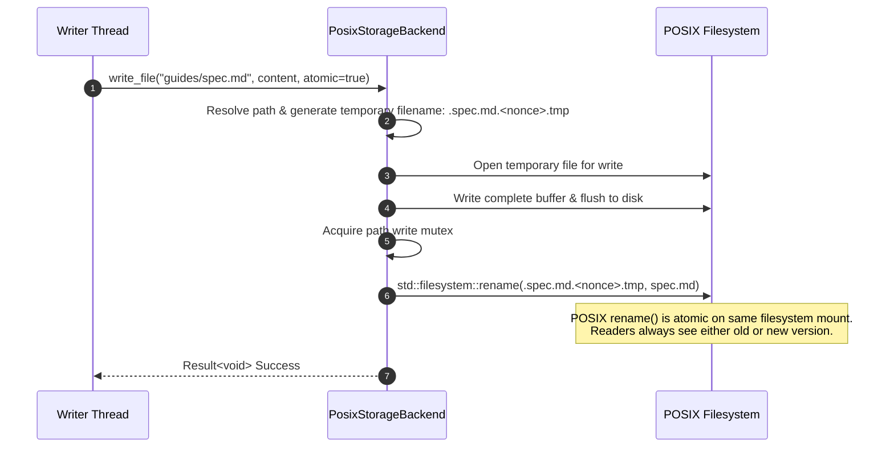

# Storage Abstraction Layer & Atomic Writes

## Storage Abstraction Layer (SAL) Interface

The C++ backend accesses the filesystem exclusively via the abstract interface `cme::storage::IStorageBackend`. This design allows future backend implementations (such as Amazon S3, Google Cloud Storage, or Ceph) without modifying collaborative editing or REST route handlers.

```cpp
class IStorageBackend {
public:
    virtual Result<void> write_file(const std::string& path, std::string_view content, bool atomic = true) = 0;
    virtual Result<std::string> read_file(const std::string& path) = 0;
    virtual Result<void> create_directory(const std::string& path) = 0;
    virtual Result<bool> exists(const std::string& path) = 0;
    virtual Result<NodeInfo> get_node_info(const std::string& path) = 0;
    virtual Result<std::vector<NodeInfo>> list_directory(const std::string& path, bool recursive = false) = 0;
    virtual Result<void> move_node(const std::string& src, const std::string& dst) = 0;
    virtual Result<std::string> delete_to_trash(const std::string& path) = 0;
    virtual Result<void> restore_from_trash(const std::string& trash_id, const std::string& restore_path) = 0;
    virtual Result<void> purge_from_trash(const std::string& trash_id) = 0;
    virtual Result<std::vector<NodeInfo>> list_trash() = 0;
    virtual Result<bool> is_bundle(const std::string& path) = 0;
};
```

---

## Atomic Write Protocol

When multiple collaborators or automated background persistence flushes write document changes, a naive `std::ofstream` direct write could allow concurrent readers to observe partially written markdown, or cause data corruption if a server crash occurs mid-write.

To prevent partial reads and guarantee crash consistency, `PosixStorageBackend::write_file()` implements a **Two-Phase Atomic Replacement Protocol**:



### Safety Guarantees
1. **Same-Filesystem Inode Swap:** Because the temporary file is created in the exact same parent directory as the target, `rename()` operates as an atomic pointer swap on the filesystem inode table.
2. **Crash Consistency:** If power fails during write, only the orphaned `.tmp` file remains; the original document remains completely uncorrupted.
3. **Concurrent Thread Safety:** Mutex serialization protects renames against concurrent moves and trash operations.

---

## Path Traversal Protection

All paths passed to the SAL interface are sanitized using `resolve_safe_path()`:
* Any relative path component containing `..` or attempting to escape the configured `content/` or `trash/` root directory is rejected with `cme::ErrorCode::InvalidArgument`.
* Leading slashes or redundant separators are normalized safely.
